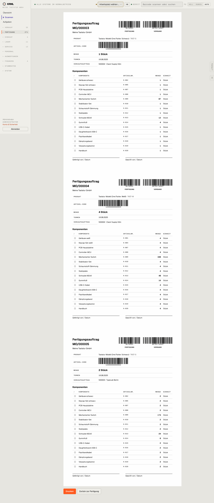

# 305-fertigung-druck — Sammeldruck Fertigung

- **Bereich:** Fertigung
- **Route:** `/fertigung/druck?ids=d935247e-e20a-4e0c-9121-ac09081e25e8,067bd300-10a1-48f8-a1ee-22f2ba49e678,2154e051-0260-441b-bb11-be0b3e1ac456`
- **Note:** 4 / 5
- **Zweck:** Sammeldruck mehrerer Fertigungszettel (mit ?ids=)
- **Messwerte:** HTTP 200 · Ladezeit 888 ms · Seitenhöhe 3386 px · horizontaler Überlauf nein · Texte < 11 px: 46

## Was gut ist

- Jeder Auftrag auf eigener Seite (Seitenumbruch)
- Gleiches Layout wie Einzeldruck

## Befunde

| Schwere | Kategorie | Befund | Vorschlag |
|---|---|---|---|
| **mittel** | Navigation | Ohne Parameter 404 (englisch, siehe A01). | Ohne Auswahl zurück zur Fertigungsliste mit Hinweis. |
| **niedrig** | Status | Termin 16.08.2025 (über ein Jahr überfällig) ohne Kennzeichnung auf dem Zettel. | ‚überfällig‘ markieren oder Priorität drucken. |

[← zur Übersicht](../README.md)
