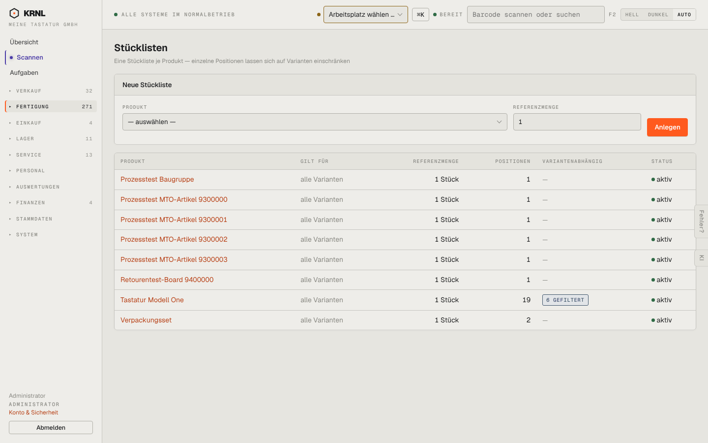

# 310-stuecklisten — Stücklisten

- **Bereich:** Fertigung
- **Route:** `/fertigung/stuecklisten`
- **Note:** 4 / 5
- **Zweck:** Stücklisten je Produkt verwalten
- **Messwerte:** HTTP 200 · Ladezeit 787 ms · Seitenhöhe 900 px · horizontaler Überlauf nein · Texte < 11 px: 22

## Was gut ist

- Übersicht mit Positionszahl und Variantenabhängigkeit (‚6 gefiltert‘)
- Status aktiv je Stückliste

## Befunde

| Schwere | Kategorie | Befund | Vorschlag |
|---|---|---|---|
| **niedrig** | Layout | Formular ‚Neue Stückliste‘ steht über der Liste und nimmt die prominenteste Fläche ein. | Knopf ‚Neue Stückliste‘ im Kopf, Formular als Dialog. |
| **niedrig** | Daten | Keine Kosten je Stückliste (Material + Lohn) in der Übersicht. | Spalte ‚Herstellkosten (kalkuliert)‘. |

[← zur Übersicht](../README.md)
