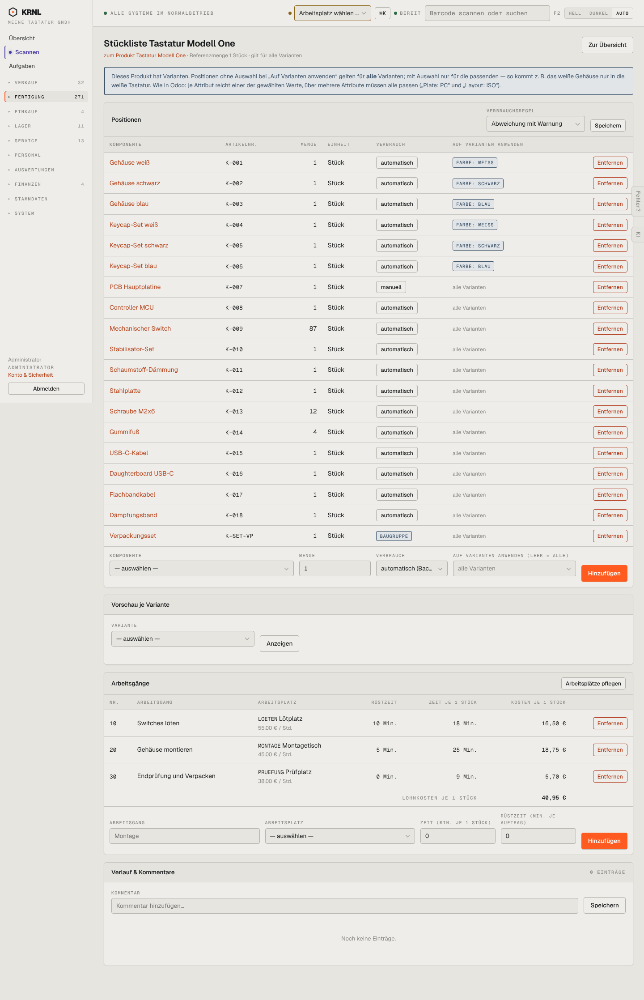

# 311-stueckliste — Stückliste Detail

- **Bereich:** Fertigung
- **Route:** `/fertigung/stuecklisten/33734b9f-22e9-470e-b4d1-af22725a4bc6`
- **Note:** 3 / 5
- **Zweck:** Stückliste mit Komponenten, Varianten-Filtern und Arbeitsgängen pflegen
- **Messwerte:** HTTP 200 · Ladezeit 833 ms · Seitenhöhe 2235 px · horizontaler Überlauf nein · Texte < 11 px: 45

## Was gut ist

- Erklärbox zu Variantenregeln mit Beispiel
- Arbeitsgänge mit Rüstzeit, Zeit und Kosten je Stück, Summe Lohnkosten
- Baugruppe als eigenes Etikett

## Befunde

| Schwere | Kategorie | Befund | Vorschlag |
|---|---|---|---|
| **mittel** | Konsistenz | Jede Zeile hat einen roten ‚Entfernen‘-Knopf – 19 rote Knöpfe untereinander, visuell lauter als der Inhalt. | Entfernen als Icon/Zeilenmenü. |
| **mittel** | Eingabe | Verbrauchsart als Knopf (‚automatisch‘/‚manuell‘) – nicht erkennbar, dass ein Klick umschaltet. | Segment-Schalter oder Auswahl. |
| **mittel** | Texte | Erklärbox erwähnt ‚Wie in Odoo‘ – Nutzer kennen Odoo nicht zwingend. | Odoo-Bezug entfernen. |
| **niedrig** | Daten | Keine Materialkostensumme; ‚Vorschau je Variante‘ erfordert Auswahl + Klick statt sofortiger Anzeige. | Materialkosten je Variante als Tabelle direkt sichtbar. |

[← zur Übersicht](../README.md)
