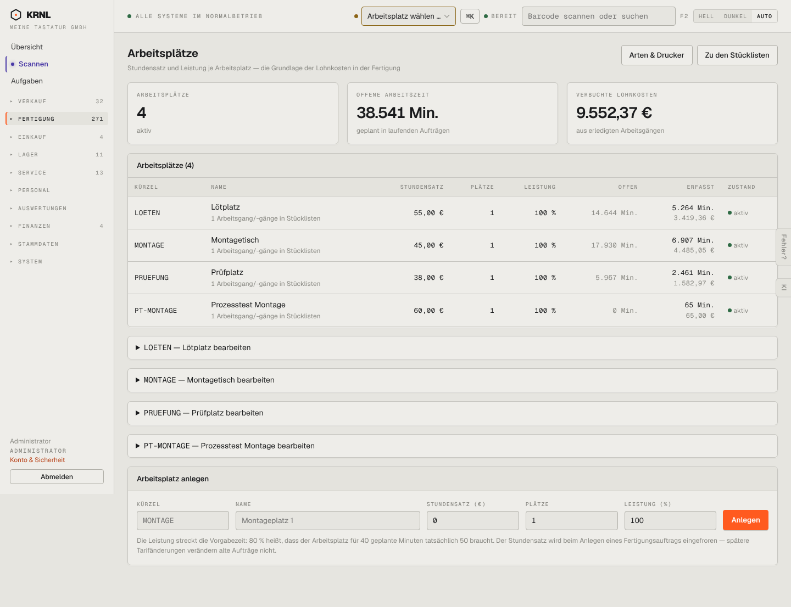

# 320-arbeitsplaetze — Arbeitsplätze

- **Bereich:** Fertigung
- **Route:** `/fertigung/arbeitsplaetze`
- **Note:** 4 / 5
- **Zweck:** Arbeitsplätze mit Stundensatz und Leistung
- **Messwerte:** HTTP 200 · Ladezeit 739 ms · Seitenhöhe 1106 px · horizontaler Überlauf nein · Texte < 11 px: 49

## Was gut ist

- Kennzahlen (offene Arbeitszeit, verbuchte Lohnkosten)
- Erklärung zu Leistung und eingefrorenem Stundensatz

## Befunde

| Schwere | Kategorie | Befund | Vorschlag |
|---|---|---|---|
| **mittel** | Layout | Je Arbeitsplatz eine eigene einklappbare Zeile ‚… bearbeiten‘ unter der Tabelle – Bearbeiten gehört in die Tabellenzeile. | Zeile anklicken → Bearbeiten im Dialog/inline. |
| **niedrig** | Texte | ‚1 Arbeitsgang/-gänge in Stücklisten‘ – Klammer-Plural; ‚Offen 14.644 Min.‘ besser in Stunden. | ‚1 Arbeitsgang‘; Zeiten ab 60 Min. in h. |
| **niedrig** | Navigation | ‚Arbeitsplatz wählen …‘ in der Kopfleiste meint etwas anderes (Gerät/Station) als diese Arbeitsplätze (Kostenstellen) – Begriffskollision. | Kopfleiste ‚Station‘ oder ‚Gerät‘ nennen. |

[← zur Übersicht](../README.md)
