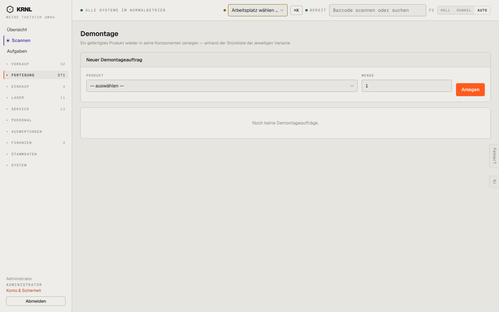

# 330-demontage — Demontage

- **Bereich:** Fertigung
- **Route:** `/fertigung/demontage`
- **Note:** 3 / 5
- **Zweck:** Demontageauftrag anlegen (Produkt in Komponenten zerlegen)
- **Messwerte:** HTTP 200 · Ladezeit 737 ms · Seitenhöhe 900 px · horizontaler Überlauf nein · Texte < 11 px: 15

## Was gut ist

- Klare Erklärung im Untertitel
- Leerzustand

## Befunde

| Schwere | Kategorie | Befund | Vorschlag |
|---|---|---|---|
| **niedrig** | Funktion | Kein Hinweis, welche Produkte überhaupt zerlegbar sind (Bestand > 0, Stückliste vorhanden) und dass B-Ware bewusst nicht demontiert wird (Retouren-Entscheidung). | Auswahl auf zerlegbare Produkte mit Bestand beschränken, Hinweis zur B-Ware. |

[← zur Übersicht](../README.md)
