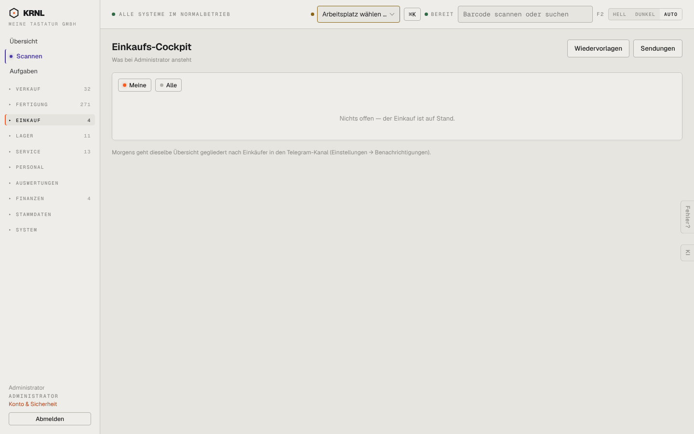

# 400-cockpit — Einkaufs-Cockpit

- **Bereich:** Einkauf
- **Route:** `/einkauf/cockpit`
- **Note:** 2 / 5
- **Zweck:** Persönliche Einkaufs-Arbeitsliste (was bei mir ansteht)
- **Messwerte:** HTTP 200 · Ladezeit 760 ms · Seitenhöhe 900 px · horizontaler Überlauf nein · Texte < 11 px: 13

## Was gut ist

- Filter Meine/Alle
- Hinweis, dass dieselbe Übersicht morgens nach Telegram geht

## Befunde

| Schwere | Kategorie | Befund | Vorschlag |
|---|---|---|---|
| **hoch** | Logik | ‚Nichts offen — der Einkauf ist auf Stand‘, während das Menü Einkauf 4 zeigt, die Bestellliste ‚Zu senden (2)‘ meldet, 27 Bestellungen ‚Rechnung erwartet‘ haben und die Übersicht 3 fällige Wiedervorlagen und 9 überfällige Wareneingänge nennt. | Cockpit muss dieselben Quellen wie Menüzähler und Übersicht nutzen; bei ‚Meine‘ = leer Hinweis ‚Unter Alle stehen 14 Punkte‘. |
| **mittel** | Layout | Leerseite ohne Struktur (welche Kategorien das Cockpit überhaupt prüft). | Abschnitte mit Zählern (Zu senden, Bestätigung fehlt, Verspätet, Rechnung fehlt, Wiedervorlagen) – auch bei 0 sichtbar. |

[← zur Übersicht](../README.md)
