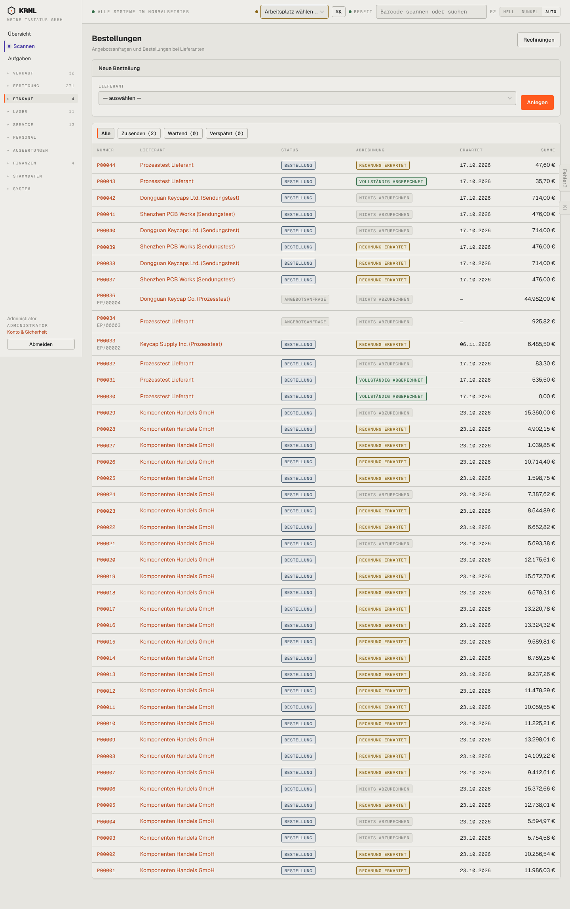

# 401-bestellungen — Bestellungen

- **Bereich:** Einkauf
- **Route:** `/einkauf`
- **Note:** 2 / 5
- **Zweck:** Angebotsanfragen und Bestellungen bei Lieferanten
- **Messwerte:** HTTP 200 · Ladezeit 1037 ms · Seitenhöhe 2294 px · horizontaler Überlauf nein · Texte < 11 px: 106

## Was gut ist

- Abrechnungsstatus je Bestellung (Rechnung erwartet / vollständig abgerechnet)
- Filter mit Zählern (Zu senden, Wartend, Verspätet)
- Projektbezug (EP/…) unter der Nummer

## Befunde

| Schwere | Kategorie | Befund | Vorschlag |
|---|---|---|---|
| **hoch** | Status | Spalte Status zeigt fast überall ‚BESTELLUNG‘ (Belegart) – ob bestätigt, versendet, teilgeliefert oder geliefert, ist nicht erkennbar; ein Lieferstatus fehlt ganz. | Status = Lieferfortschritt (bestellt → bestätigt → unterwegs → teilweise/vollständig eingegangen), Belegart nur bei Anfragen. |
| **mittel** | Texte | ‚NICHTS ABZURECHNEN‘ bei Bestellungen über 15.360 € – gemeint ist ‚noch nichts eingegangen‘; liest sich wie ‚kostenlos‘. | ‚Noch kein Eingang‘. |
| **mittel** | Leistung | Keine Suche, keine Seitenaufteilung; ‚Neue Bestellung‘-Formular dominiert den Seitenkopf. | Suche (Lieferant, Nummer, Artikel), Seitenaufteilung, ‚Neue Bestellung‘ als Knopf. |
| **niedrig** | Daten | P00030 mit Summe 0,00 € ‚vollständig abgerechnet‘. | Nullbestellungen kennzeichnen. |

[← zur Übersicht](../README.md)
