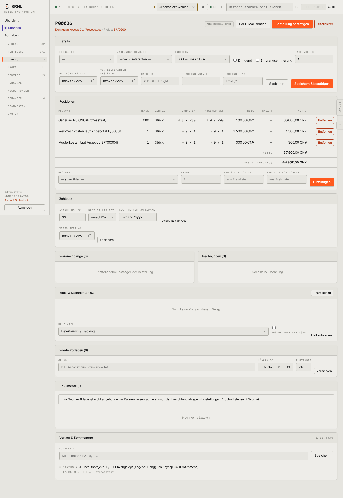

# 402-bestellung-entwurf — Bestellung Entwurf

- **Bereich:** Einkauf
- **Route:** `/einkauf/5bc27194-bc16-4caa-92f3-74c768c084c4`
- **Note:** 2 / 5
- **Zweck:** Angebotsanfrage/Bestellentwurf bearbeiten und bestätigen
- **Messwerte:** HTTP 200 · Ladezeit 771 ms · Seitenhöhe 2084 px · horizontaler Überlauf nein · Texte < 11 px: 50

## Was gut ist

- Mengen ‚erhalten/abgerechnet‘ je Position
- Zahlplan mit Anzahlung
- Mail-Vorlagen direkt am Beleg, Wiedervorlage, Dokumente

## Befunde

| Schwere | Kategorie | Befund | Vorschlag |
|---|---|---|---|
| **kritisch** | Logik | Bestellung bei einem chinesischen Lieferanten in CNY rechnet 19 % deutsche USt auf: Netto 37.800 CNY → ‚Gesamt (brutto) 44.982 CNY‘. Bei Import fällt keine USt des Lieferanten an (EUSt erst beim Zoll). | Steuersatz aus Lieferant/Land ableiten (Drittland = 0 %), Brutto-Zeile bei 0 % weglassen. |
| **hoch** | Layout | Neun Karten (Details, Positionen, Zahlplan, Wareneingänge, Rechnungen, Mails, Wiedervorlagen, Dokumente, Verlauf) auf ~2.000 px; zwei orange Primärknöpfe (‚Bestellung bestätigen‘ oben, ‚Speichern & bestätigen‘ in Details). | Reiter (Übersicht · Kommunikation · Dokumente · Verlauf) und genau eine Primäraktion. |
| **hoch** | Eingabe | Alle Datumsfelder (ETA, bestätigt, Rest-Termin, Verschifft am) im US-Format mm/dd/yyyy. | Deutsches Datumsformat (global). |
| **mittel** | Texte | Feld ‚Tage vorher‘ neben ‚Empfangserinnerung‘ ohne Bezug; ‚Zahlplan anlegen‘ und ‚Speichern‘ in derselben Karte mit unterschiedlicher Wirkung. | ‚Erinnerung … Tage vor ETA‘ als ein Satz-Feld. |
| **niedrig** | Konsistenz | Hinweis ‚Google-Ablage nicht angebunden‘ erscheint auf jedem Beleg erneut. | Einmal global (Einrichtung), auf Belegen nur deaktivierter Upload mit Tooltip. |

[← zur Übersicht](../README.md)
