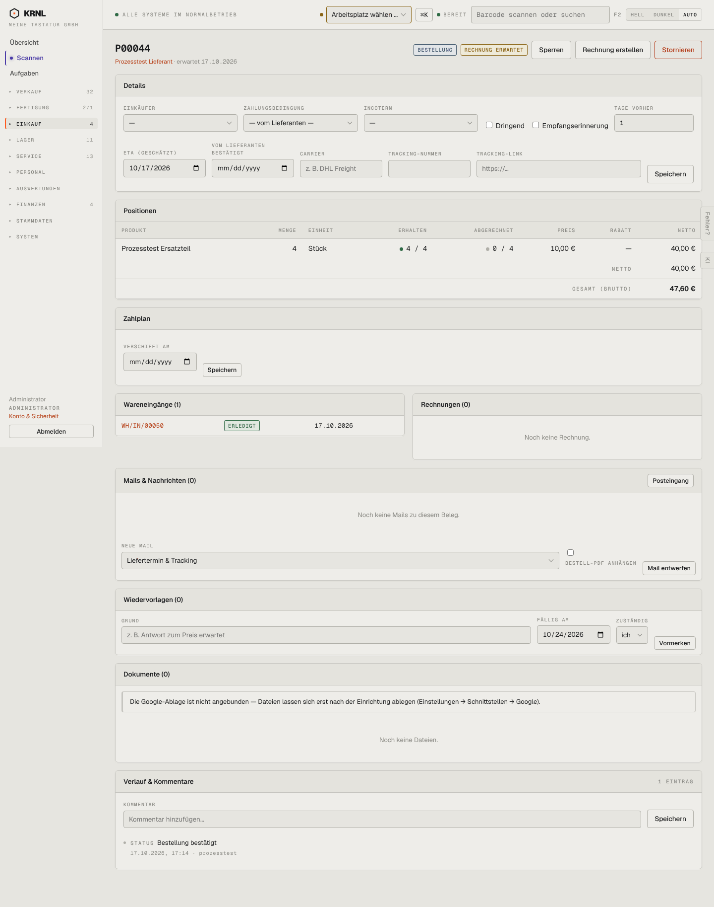

# 403-bestellung-bestellt — Bestellung bestellt

- **Bereich:** Einkauf
- **Route:** `/einkauf/6a588a64-e29f-4096-8214-dc7cc8e06e08`
- **Note:** 3 / 5
- **Zweck:** Bestätigte Bestellung mit Wareneingang, Rechnung erwartet
- **Messwerte:** HTTP 200 · Ladezeit 820 ms · Seitenhöhe 1826 px · horizontaler Überlauf nein · Texte < 11 px: 45

## Was gut ist

- Zwei Statusetiketten (Bestellung + Rechnung erwartet)
- Wareneingang mit Status verlinkt
- ‚Rechnung erstellen‘ als nächster Schritt

## Befunde

| Schwere | Kategorie | Befund | Vorschlag |
|---|---|---|---|
| **mittel** | Schritte | Nächster Schritt ‚Rechnung erstellen‘ ist ein grauer Sekundärknopf zwischen ‚Sperren‘ und rotem ‚Stornieren‘. | Nächsten Schritt primär hervorheben. |
| **mittel** | Logik | Karte ‚Zahlplan‘ enthält nur das Feld ‚Verschifft am‘ – für eine gelieferte Inlandsbestellung sinnlos. | Zahlplan/Verschiffung nur bei Import/Anzahlung zeigen. |
| **niedrig** | Logik | Details (Incoterm, Tracking, Carrier) bleiben nach vollständigem Eingang editierbar. | Nach Eingang schreibgeschützt. |

[← zur Übersicht](../README.md)
