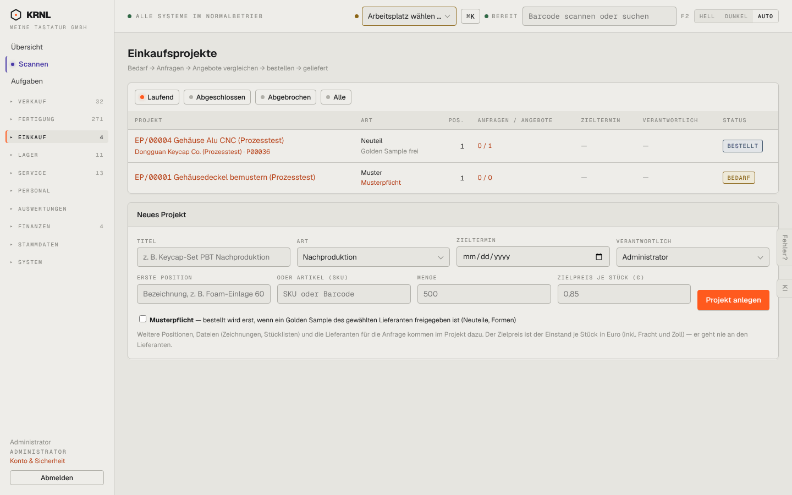

# 410-projekte — Einkaufsprojekte

- **Bereich:** Einkauf
- **Route:** `/einkauf/projekte`
- **Note:** 3 / 5
- **Zweck:** Einkaufsprojekte (Bedarf → Anfragen → Angebote → bestellen → geliefert)
- **Messwerte:** HTTP 200 · Ladezeit 774 ms · Seitenhöhe 900 px · horizontaler Überlauf nein · Texte < 11 px: 30

## Was gut ist

- Prozesskette im Untertitel
- Spalte Anfragen/Angebote
- Musterpflicht sichtbar

## Befunde

| Schwere | Kategorie | Befund | Vorschlag |
|---|---|---|---|
| **mittel** | Layout | Formular ‚Neues Projekt‘ mit 9 Feldern dauerhaft unter der Liste. | Knopf ‚Neues Projekt‘ → Dialog. |
| **niedrig** | Daten | Zieltermin und Verantwortlicher bei allen Projekten ‚—‘ – die Spalten sind leer, ohne Hinweis, dass etwas fehlt. | Fehlende Pflichtangaben markieren. |

[← zur Übersicht](../README.md)
