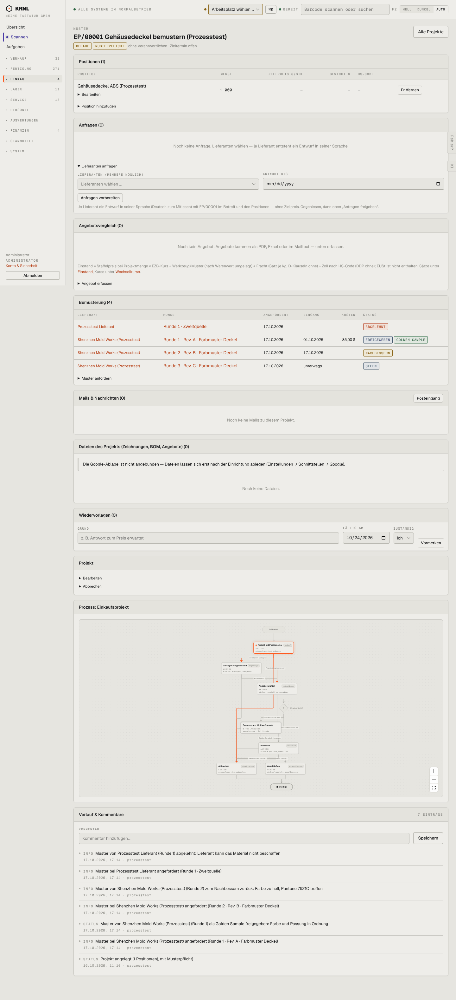

# 411-projekt-bedarf — Projekt Bedarf

- **Bereich:** Einkauf
- **Route:** `/einkauf/projekte/239acd9e-0634-47b1-98f2-aa8fb4656070`
- **Note:** 2 / 5
- **Zweck:** Einkaufsprojekt mit Musterpflicht im Status Bedarf
- **Messwerte:** HTTP 200 · Ladezeit 936 ms · Seitenhöhe 3153 px · horizontaler Überlauf nein · Texte < 11 px: 126

## Was gut ist

- Bemusterung mit Runden, Status und Golden Sample
- Einstand-Formel erklärt mit Links zu Sätzen/Kursen
- Lieferantenanfrage in Lieferantensprache

## Befunde

| Schwere | Kategorie | Befund | Vorschlag |
|---|---|---|---|
| **hoch** | Status | Projekt steht auf ‚BEDARF‘ und das Diagramm auf dem ersten Schritt, obwohl die Bemusterung läuft und bereits ein Golden Sample freigegeben ist (Teilprozess 3/4). Anfragen (0) – die Muster wurden ohne Anfrage angefordert. | Projektstatus aus Teilprozessen ableiten (‚Bemusterung‘), Bemusterung ohne Anfrage zulassen, aber sichtbar. |
| **hoch** | Logik | Nach freigegebenem Golden Sample (Runde 1) laufen Runde 2 (Nachbessern) und 3 (offen) weiter; Eingang Runde 1 am 01.10., angefordert am 17.10. – Eingang vor Anforderung. | Nach Golden Sample weitere Runden nur bewusst (neue Revision); Datumsplausibilität prüfen. |
| **mittel** | Layout | Neun Karten + Prozessdiagramm ~3.100 px; ‚Bearbeiten‘/‚Abbrechen‘ des Projekts als Aufklapper tief unten. | Projektkopf mit Status-Stepper und Aktionen oben, Rest in Reitern. |
| **niedrig** | Konsistenz | Musterkosten ‚85,00 $‘ neben €-Beträgen ohne Umrechnung. | Fremdwährung + Eurowert. |

[← zur Übersicht](../README.md)
