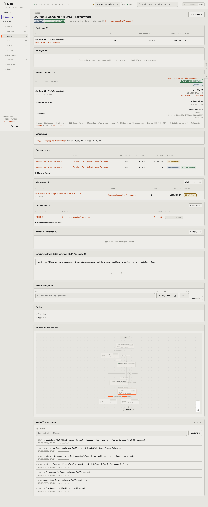

# 412-projekt-bestellt — Projekt bestellt

- **Bereich:** Einkauf
- **Route:** `/einkauf/projekte/40c0534e-acd7-4069-82c5-92af745c03f2`
- **Note:** 2 / 5
- **Zweck:** Einkaufsprojekt nach Entscheidung und Bestellung
- **Messwerte:** HTTP 200 · Ladezeit 918 ms · Seitenhöhe 3496 px · horizontaler Überlauf nein · Texte < 11 px: 108

## Was gut ist

- Angebotsvergleich mit Einstand je Stück, Abweichung zum Ziel (−16,9 %)
- Entscheidung dokumentiert (wer, wann, welcher Einstand)
- Werkzeuge am Projekt

## Befunde

| Schwere | Kategorie | Befund | Vorschlag |
|---|---|---|---|
| **kritisch** | Status | Projekt ‚BESTELLT‘, die verknüpfte Bestellung P00036 steht aber noch auf ‚ANGEBOTSANFRAGE‘ (nicht bestätigt, nicht versendet). | ‚Bestellt‘ erst nach Bestätigung der Bestellung; sonst ‚Bestellung vorbereitet‘. |
| **mittel** | Typografie | Einstand ‚24,942 €‘ mit drei Nachkommastellen. | Zwei Nachkommastellen (oder 4 bei Stückpreisen konsistent). |
| **mittel** | Daten | Rote Warnung ‚kein Zollsatz zum HS-Code‘ – der Einstand ist damit zu niedrig, wird aber als ‚günstigster Einstand‘ ausgezeichnet. | Einstand als ‚unvollständig‘ markieren, solange Zoll fehlt. |
| **niedrig** | Logik | Werkzeug ‚IN AUFTRAG‘, obwohl die Bestellung nicht bestätigt ist. | Werkzeugstatus an Bestellstatus koppeln. |

[← zur Übersicht](../README.md)
