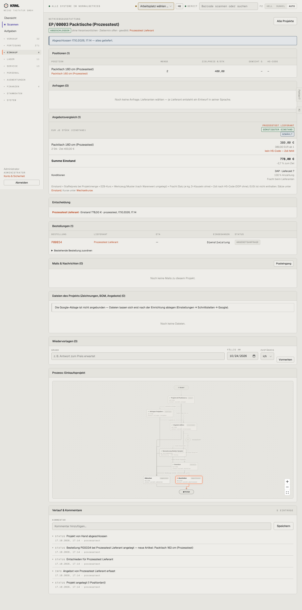

# 413-projekt-abgeschlossen — Projekt abgeschlossen

- **Bereich:** Einkauf
- **Route:** `/einkauf/projekte/7ed478f9-77c4-4a80-b1df-3f4ea57e4bb5`
- **Note:** 2 / 5
- **Zweck:** Abgeschlossenes Einkaufsprojekt
- **Messwerte:** HTTP 200 · Ladezeit 854 ms · Seitenhöhe 2902 px · horizontaler Überlauf nein · Texte < 11 px: 74

## Was gut ist

- Abschluss-Hinweis mit Datum ‚alles geliefert‘

## Befunde

| Schwere | Kategorie | Befund | Vorschlag |
|---|---|---|---|
| **hoch** | Logik | ‚Abgeschlossen — alles geliefert‘, die zugehörige Bestellung P00034 steht aber auf ‚ANGEBOTSANFRAGE‘, Spalte Eingegangen ‚Dienstleistung‘. | Abschluss nur bei bestätigten/gelieferten Bestellungen; Dienstleistungen als ‚erbracht‘ führen. |
| **niedrig** | Logik | Wiedervorlage-Formular und Bearbeiten bleiben auf dem abgeschlossenen Projekt aktiv. | Abgeschlossene Projekte schreibgeschützt. |

[← zur Übersicht](../README.md)
