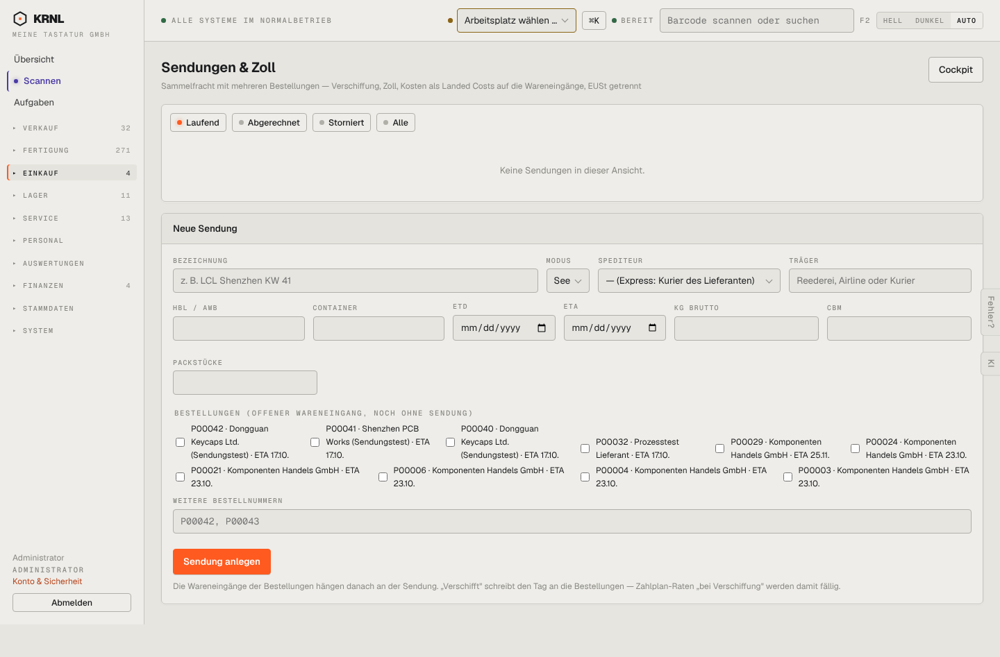

# 420-sendungen — Sendungen & Zoll

- **Bereich:** Einkauf
- **Route:** `/einkauf/sendungen`
- **Note:** 3 / 5
- **Zweck:** Sammelfracht/Zoll: Sendungen mit mehreren Bestellungen
- **Messwerte:** HTTP 200 · Ladezeit 747 ms · Seitenhöhe 947 px · horizontaler Überlauf nein · Texte < 11 px: 26

## Was gut ist

- Erklärung, was ‚Verschifft‘ auslöst (Zahlplan-Raten)
- Bestellungen ohne Sendung als Auswahl

## Befunde

| Schwere | Kategorie | Befund | Vorschlag |
|---|---|---|---|
| **mittel** | Layout | Bestellungs-Checkboxen fließen unregelmäßig in 6 Spalten mit mehrzeiligen Labels; Checkbox und Text nicht ausgerichtet. | Tabelle mit Checkbox-Spalte (Bestellung, Lieferant, ETA, Wert). |
| **niedrig** | Eingabe | Platzhalter ‚P00042, P00043‘ im Feld ‚Weitere Bestellnummern‘ sieht wie vorbefüllter Wert aus. | Platzhalter ‚z. B. …‘ und hellere Farbe. |
| **niedrig** | Filter | Standardfilter ‚Laufend‘ leer – abgerechnete Sendungen erst nach Klick. | Bei leerem Standardfilter Hinweis ‚2 abgerechnete‘. |

[← zur Übersicht](../README.md)
