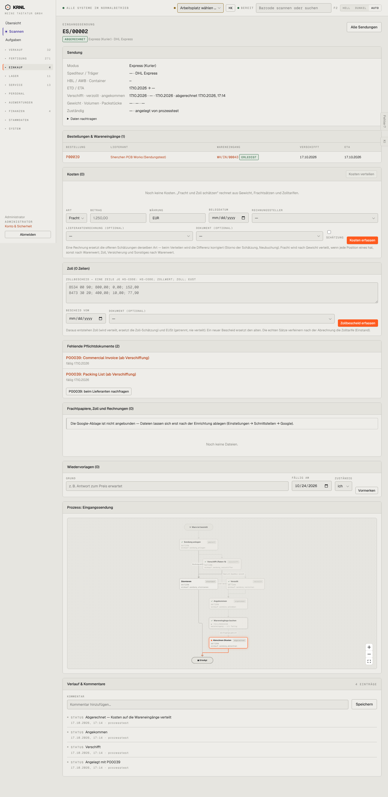

# 421-sendung-abgerechnet — Sendung abgerechnet

- **Bereich:** Einkauf
- **Route:** `/einkauf/sendungen/344200ba-2a6e-4a7d-9d0e-9eb2a54ac782`
- **Note:** 2 / 5
- **Zweck:** Abgerechnete Eingangssendung
- **Messwerte:** HTTP 200 · Ladezeit 854 ms · Seitenhöhe 2952 px · horizontaler Überlauf nein · Texte < 11 px: 84

## Was gut ist

- Sendungsdaten kompakt als Liste
- Fehlende Pflichtdokumente mit ‚beim Lieferanten nachfragen‘
- Zollbescheid-Erfassung mit Erklärung

## Befunde

| Schwere | Kategorie | Befund | Vorschlag |
|---|---|---|---|
| **hoch** | Logik | Status ‚ABGERECHNET — Kosten auf die Wareneingänge verteilt‘, aber Kosten (0) und Zoll (0 Zeilen): abgerechnet ohne Kosten; Formulare für Kosten und Zoll sind weiter offen. | Abrechnen ohne Kosten nur mit Bestätigung (‚Frei Haus?‘); danach Formulare sperren oder ‚Nachbuchung‘ kennzeichnen. |
| **mittel** | Eingabe | Zollbescheid als Freitext-Syntax ‚HS-Code; Zollwert; Zoll; EUSt‘ je Zeile; Platzhalter sieht wie echte Daten aus. | Tabellarische Eingabe mit Zeilen hinzufügen. |
| **mittel** | Status | ‚Fehlende Pflichtdokumente (2)‘ bei bereits abgerechneter Sendung – ohne Hinweis, ob das jetzt noch blockiert. | Klar ‚nachzureichen (blockiert nicht)‘. |
| **niedrig** | Typografie | Platzhalter-Ketten ‚— · — · —‘ für leere Gewicht/Volumen/Packstücke. | Leere Felder ausblenden. |

[← zur Übersicht](../README.md)
