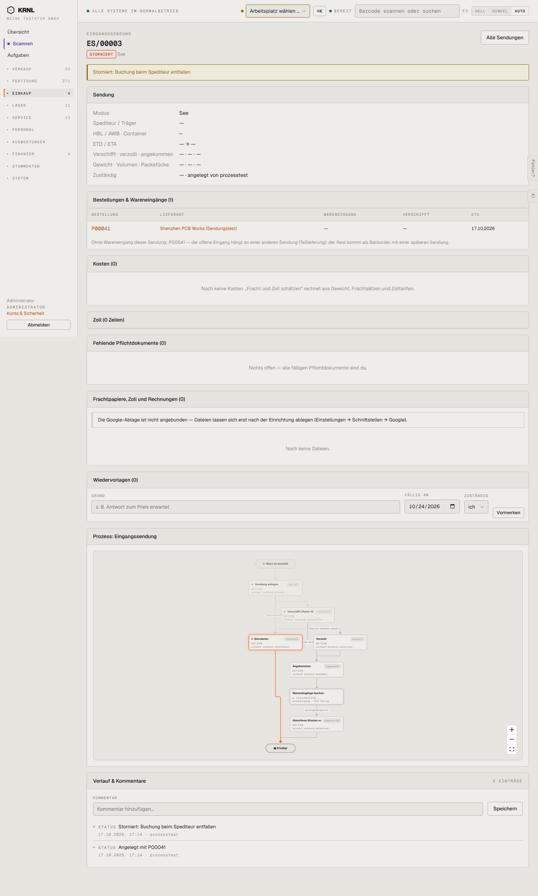

# 422-sendung-storniert — Sendung storniert

- **Bereich:** Einkauf
- **Route:** `/einkauf/sendungen/8f851b7f-24e9-4bda-9152-3146615549df`
- **Note:** 3 / 5
- **Zweck:** Stornierte Sendung
- **Messwerte:** HTTP 200 · Ladezeit 859 ms · Seitenhöhe 2396 px · horizontaler Überlauf nein · Texte < 11 px: 53

## Was gut ist

- Storno-Grund als Banner
- Erklärung zum Backorder-Rest

## Befunde

| Schwere | Kategorie | Befund | Vorschlag |
|---|---|---|---|
| **niedrig** | Logik | Wiedervorlage-Formular auf stornierter Sendung aktiv; leere Kosten/Zoll-Karten weiter sichtbar. | Stornierte Belege reduziert anzeigen. |

[← zur Übersicht](../README.md)
