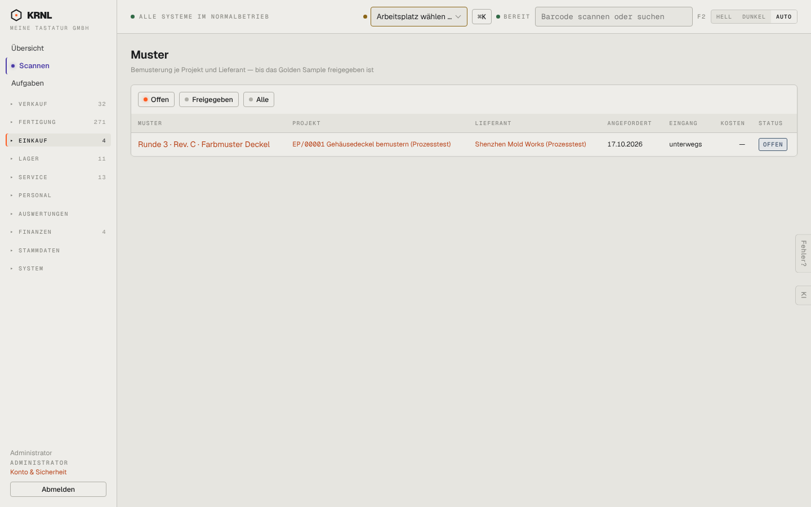

# 430-muster — Muster

- **Bereich:** Einkauf
- **Route:** `/einkauf/muster`
- **Note:** 4 / 5
- **Zweck:** Offene Muster über alle Projekte
- **Messwerte:** HTTP 200 · Ladezeit 801 ms · Seitenhöhe 900 px · horizontaler Überlauf nein · Texte < 11 px: 21

## Was gut ist

- Kompakte Liste mit Projekt, Lieferant, Status

## Befunde

| Schwere | Kategorie | Befund | Vorschlag |
|---|---|---|---|
| **niedrig** | Daten | Kein Alter/keine Wartezeit (‚unterwegs seit …‘) und kein Tracking-Link. | Spalte ‚seit‘ und Tracking. |

[← zur Übersicht](../README.md)
