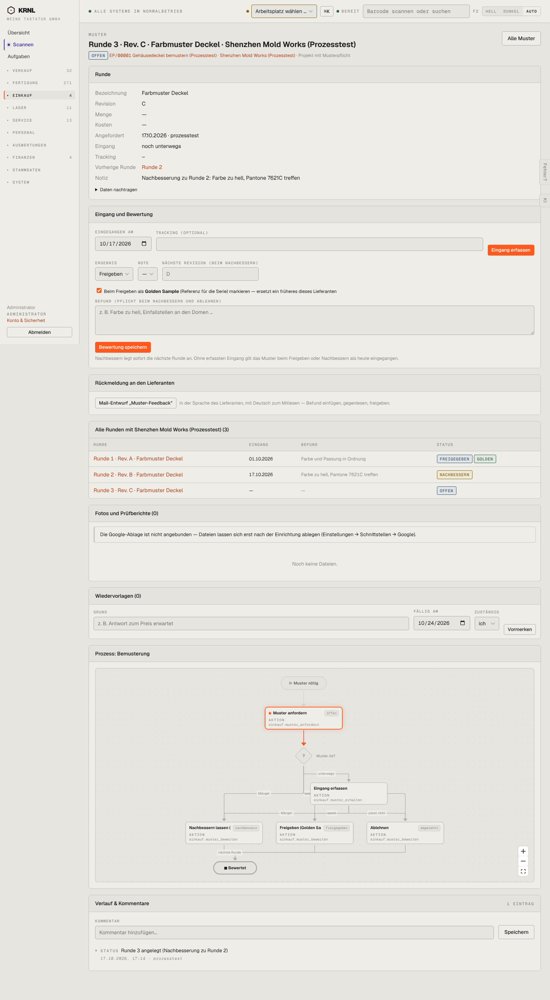

# 431-muster-offen — Muster offen

- **Bereich:** Einkauf
- **Route:** `/einkauf/muster/db9ff490-c7f2-4674-bba3-84f3e3b43573`
- **Note:** 3 / 5
- **Zweck:** Musterrunde: Eingang erfassen und bewerten
- **Messwerte:** HTTP 200 · Ladezeit 854 ms · Seitenhöhe 2615 px · horizontaler Überlauf nein · Texte < 11 px: 67

## Was gut ist

- Vorherige Runde verlinkt, Notiz der Nachbesserung sichtbar
- Übersicht aller Runden mit dem Lieferanten
- Mail-Entwurf ‚Muster-Feedback‘ in Lieferantensprache

## Befunde

| Schwere | Kategorie | Befund | Vorschlag |
|---|---|---|---|
| **hoch** | Eingabe | Bewertung ist vorbelegt mit ‚Freigeben‘ und angehaktem ‚als Golden Sample markieren‘ – ein Klick auf ‚Bewertung speichern‘ gibt ein noch nicht eingegangenes Muster als Serienreferenz frei. | Kein Standardergebnis; Golden Sample bewusst anhaken; Bewertung erst nach Eingang. |
| **mittel** | Eingabe | ‚Eingegangen am‘ ist mit heute vorbelegt, obwohl das Muster ‚noch unterwegs‘ ist. | Leer lassen. |
| **mittel** | Konsistenz | Zwei orange Knöpfe (‚Eingang erfassen‘, ‚Bewertung speichern‘) in einer Karte. | Zweistufig: erst Eingang, dann Bewertung. |

[← zur Übersicht](../README.md)
