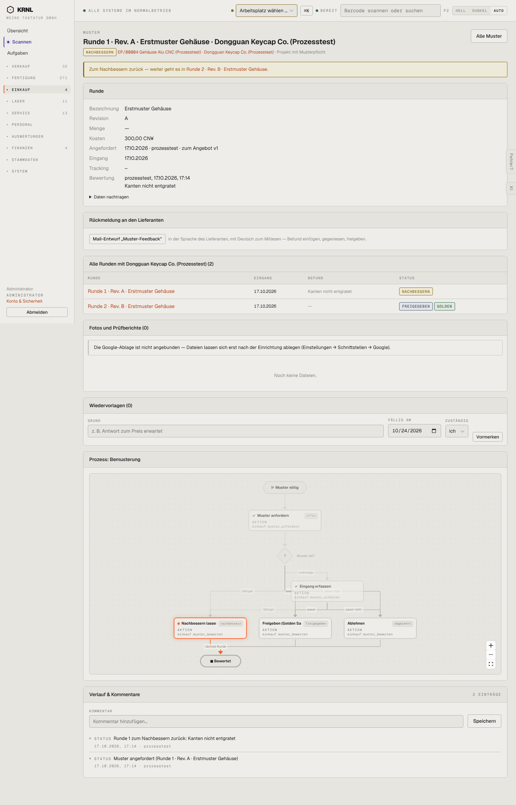

# 432-muster-nachbessern — Muster nachbessern

- **Bereich:** Einkauf
- **Route:** `/einkauf/muster/54f6f3ec-1abd-4544-bd30-4407016b124b`
- **Note:** 3 / 5
- **Zweck:** Musterrunde mit Ergebnis Nachbessern
- **Messwerte:** HTTP 200 · Ladezeit 863 ms · Seitenhöhe 2240 px · horizontaler Überlauf nein · Texte < 11 px: 62

## Was gut ist

- Banner verweist auf die Folgerunde
- Befund sichtbar

## Befunde

| Schwere | Kategorie | Befund | Vorschlag |
|---|---|---|---|
| **mittel** | Schritte | Diagramm zeigt ‚Nachbessern lassen‘ als aktuellen Schritt, obwohl die Runde abgeschlossen ist und Runde 2 bereits freigegeben wurde. | Abgeschlossene Runde als ‚erledigt (→ Runde 2)‘ darstellen. |
| **niedrig** | Logik | Wiedervorlage-Formular auf einer abgeschlossenen Runde. | Nur bei offenen Runden. |

[← zur Übersicht](../README.md)
