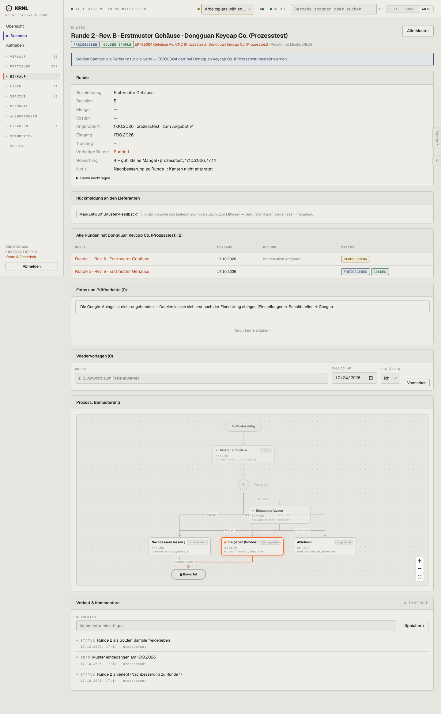

# 433-muster-freigegeben — Muster freigegeben

- **Bereich:** Einkauf
- **Route:** `/einkauf/muster/a1c53e09-fef9-4c9a-ae80-77b22d6b765f`
- **Note:** 4 / 5
- **Zweck:** Freigegebenes Golden Sample
- **Messwerte:** HTTP 200 · Ladezeit 852 ms · Seitenhöhe 2329 px · horizontaler Überlauf nein · Texte < 11 px: 65

## Was gut ist

- Banner erklärt Bedeutung (‚darf bei … bestellt werden‘)
- Bewertung mit Note und Befund

## Befunde

| Schwere | Kategorie | Befund | Vorschlag |
|---|---|---|---|
| **niedrig** | Funktion | Kein direkter Weg ‚Jetzt bestellen‘ vom freigegebenen Muster zur Bestellung/zum Projekt. | Knopf ‚Bestellung anlegen‘ im Banner. |

[← zur Übersicht](../README.md)
