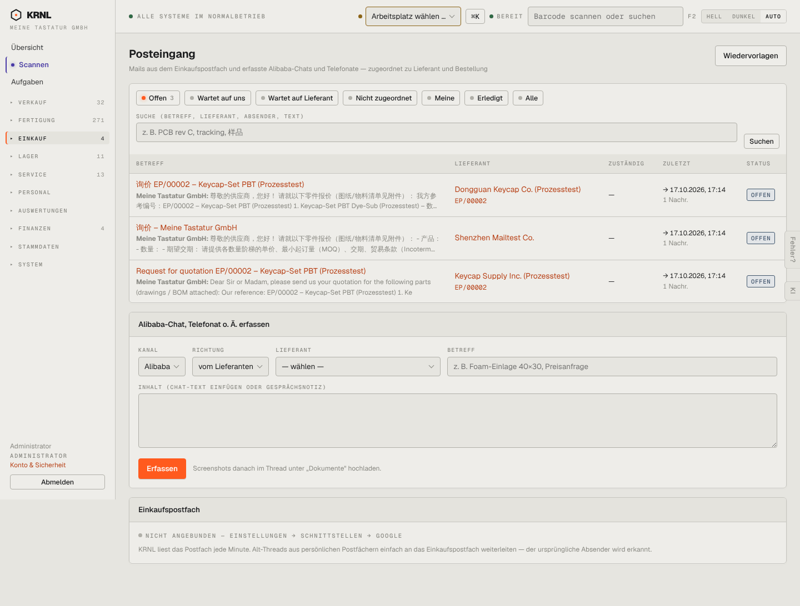

# 440-posteingang — Posteingang

- **Bereich:** Einkauf
- **Route:** `/einkauf/posteingang`
- **Note:** 3 / 5
- **Zweck:** Einkaufspostfach: Threads mit Lieferanten, Chats/Telefonate erfassen
- **Messwerte:** HTTP 200 · Ladezeit 859 ms · Seitenhöhe 1092 px · horizontaler Überlauf nein · Texte < 11 px: 27

## Was gut ist

- Filter nach Zuständigkeit (Wartet auf uns / Lieferant)
- Volltextsuche inkl. chinesischer Zeichen
- Manuelle Erfassung von Alibaba-Chats

## Befunde

| Schwere | Kategorie | Befund | Vorschlag |
|---|---|---|---|
| **hoch** | Status | Unsere eigenen, gerade versendeten Anfragen (→) stehen als ‚OFFEN‘ im Standardfilter, obwohl wir auf den Lieferanten warten. | Nach eigenem Versand automatisch ‚Wartet auf Lieferant‘. |
| **hoch** | Status | Der wichtigste Zustand – Einkaufspostfach ‚NICHT ANGEBUNDEN‘ – steht klein ganz unten. | Gelbes Banner oben, solange keine Mails eingelesen werden. |
| **niedrig** | Texte | Vorschau zeigt chinesischen Text ohne Übersetzung, obwohl die Übersetzung im Thread vorhanden ist. | Vorschau in Deutsch (Übersetzung), Original auf Wunsch. |

[← zur Übersicht](../README.md)
