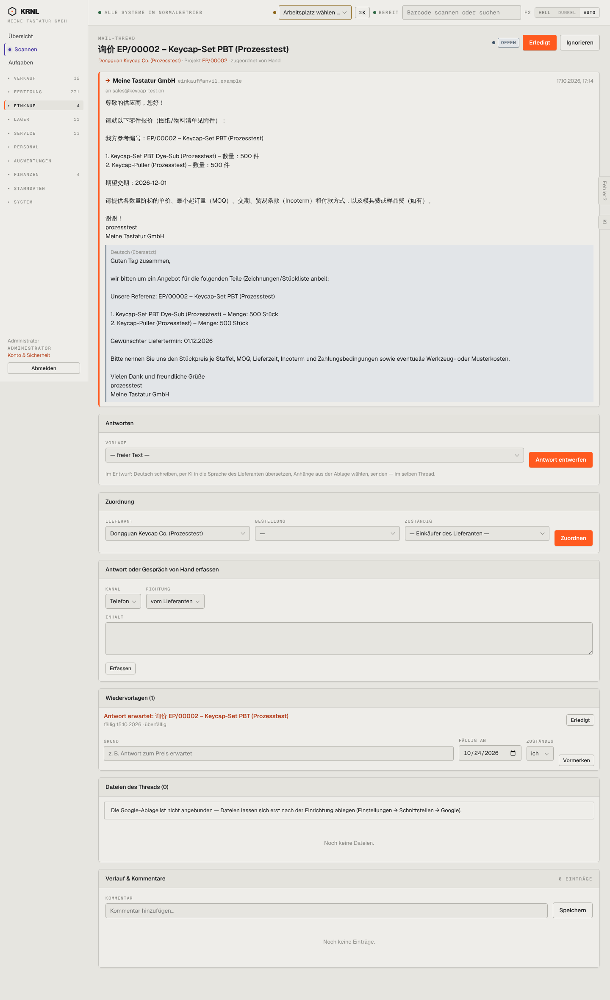

# 441-thread — Mail-Thread

- **Bereich:** Einkauf
- **Route:** `/einkauf/posteingang/f94cf301-8fd2-4c6e-bf39-0fa7b5a54176`
- **Note:** 3 / 5
- **Zweck:** Mail-Thread mit Lieferant lesen, antworten, zuordnen
- **Messwerte:** HTTP 200 · Ladezeit 789 ms · Seitenhöhe 2359 px · horizontaler Überlauf nein · Texte < 11 px: 27

## Was gut ist

- Original + deutsche Übersetzung untereinander
- Antwortentwurf mit KI-Übersetzung
- Zuordnung zu Lieferant/Bestellung/Zuständigem

## Befunde

| Schwere | Kategorie | Befund | Vorschlag |
|---|---|---|---|
| **mittel** | Konsistenz | Drei orange Primärknöpfe (Erledigt, Antwort entwerfen, Zuordnen) auf einer Seite. | Eine Primäraktion je Zustand (offen → Antworten). |
| **mittel** | Logik | Wiedervorlage ‚fällig 15.10.2026 · überfällig‘ für eine am 17.10. versendete Anfrage – Fälligkeit vor Versand. | Fälligkeit relativ zum Versand setzen. |
| **niedrig** | Daten | Projekt EP/00002 ist zugeordnet, Bestellung ‚—‘ – die Zuordnung zeigt kein Projektfeld. | Projekt als Feld in der Zuordnung. |

[← zur Übersicht](../README.md)
