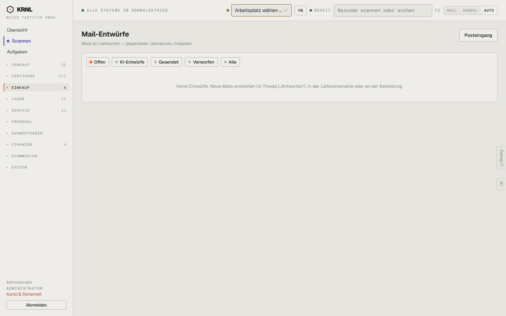

# 450-entwuerfe — Mail-Entwürfe

- **Bereich:** Einkauf
- **Route:** `/einkauf/entwuerfe`
- **Note:** 4 / 5
- **Zweck:** Mail-Entwürfe an Lieferanten (gegenlesen, freigeben)
- **Messwerte:** HTTP 200 · Ladezeit 781 ms · Seitenhöhe 900 px · horizontaler Überlauf nein · Texte < 11 px: 13

## Was gut ist

- Leerzustand erklärt, wo Entwürfe entstehen
- Filter inkl. KI-Entwürfe

## Befunde

| Schwere | Kategorie | Befund | Vorschlag |
|---|---|---|---|
| **niedrig** | Navigation | Eigener Menüpunkt für eine meist leere Liste; Entwürfe könnten im Posteingang als Filter leben. | Mit Posteingang zusammenlegen (Filter ‚Entwürfe‘). |

[← zur Übersicht](../README.md)
