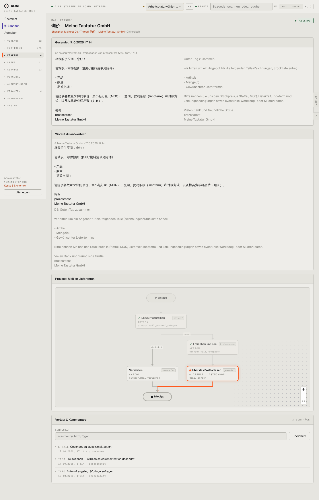

# 451-entwurf-gesendet — Entwurf gesendet

- **Bereich:** Einkauf
- **Route:** `/einkauf/entwuerfe/6767e71e-4e63-43f2-afad-7a40986e6e36`
- **Note:** 2 / 5
- **Zweck:** Gesendeter Mail-Entwurf mit Übersetzung
- **Messwerte:** HTTP 200 · Ladezeit 860 ms · Seitenhöhe 2257 px · horizontaler Überlauf nein · Texte < 11 px: 37

## Was gut ist

- Zweispaltig Original/Deutsch
- Freigabe mit Name und Zeit

## Befunde

| Schwere | Kategorie | Befund | Vorschlag |
|---|---|---|---|
| **hoch** | Logik | Die Mail wurde mit leeren Vorlagenfeldern versendet (‚产品：/ 数量：/ 期望交期：‘ = Artikel, Menge, Liefertermin leer). | Vor der Freigabe leere Platzhalter erkennen und blockieren. |
| **mittel** | Layout | ‚Worauf du antwortest‘ wiederholt denselben Text (eigene Mail) ein drittes Mal. | Zitat einklappen bzw. nur bei fremder Mail zeigen. |

[← zur Übersicht](../README.md)
