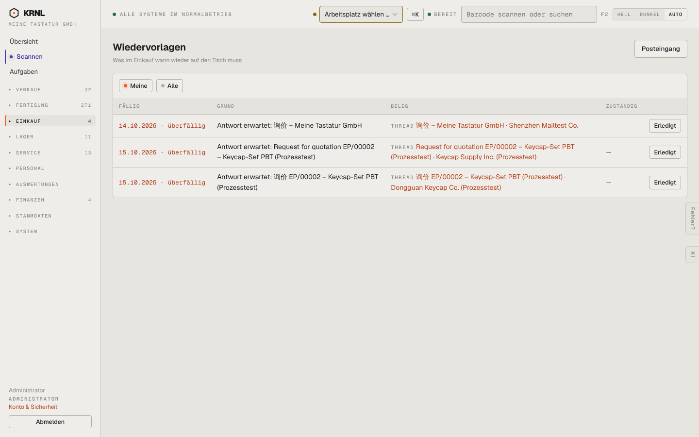

# 460-wiedervorlagen — Wiedervorlagen

- **Bereich:** Einkauf
- **Route:** `/einkauf/wiedervorlagen`
- **Note:** 3 / 5
- **Zweck:** Fällige Wiedervorlagen im Einkauf
- **Messwerte:** HTTP 200 · Ladezeit 772 ms · Seitenhöhe 900 px · horizontaler Überlauf nein · Texte < 11 px: 20

## Was gut ist

- Überfällig rot mit Datum
- Direkter Link zum Beleg, ‚Erledigt‘ je Zeile

## Befunde

| Schwere | Kategorie | Befund | Vorschlag |
|---|---|---|---|
| **mittel** | Filter | Filter ‚Meine‘ zeigt Einträge mit Zuständig ‚—‘ (niemand); gleichzeitig meldet das Cockpit ‚Nichts offen‘. | ‚Meine‘ = mir zugewiesen; Nicht-zugewiesene als eigener Filter; Cockpit nutzt dieselbe Liste. |
| **niedrig** | Funktion | Kein ‚Verschieben um …‘ (Schlummern). | Schnellaktion +1 Tag / +1 Woche. |

[← zur Übersicht](../README.md)
