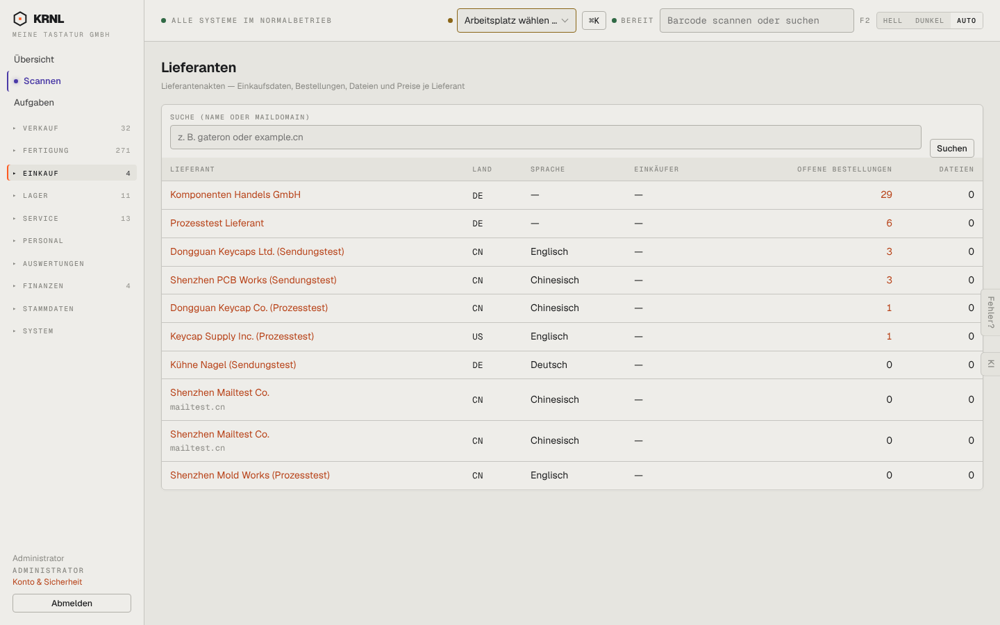

# 470-lieferanten — Lieferanten

- **Bereich:** Einkauf
- **Route:** `/einkauf/lieferanten`
- **Note:** 3 / 5
- **Zweck:** Lieferantenakten durchsuchen
- **Messwerte:** HTTP 200 · Ladezeit 851 ms · Seitenhöhe 900 px · horizontaler Überlauf nein · Texte < 11 px: 20

## Was gut ist

- Suche nach Name/Maildomain
- Offene Bestellungen je Lieferant

## Befunde

| Schwere | Kategorie | Befund | Vorschlag |
|---|---|---|---|
| **mittel** | Daten | ‚Shenzhen Mailtest Co.‘ mit identischer Domain doppelt – keine Dublettenerkennung. | Dublettenwarnung + Zusammenführen. |
| **niedrig** | Funktion | Kein Knopf ‚Neuer Lieferant‘ (nur über Kontakte). | Anlegen direkt hier. |

[← zur Übersicht](../README.md)
