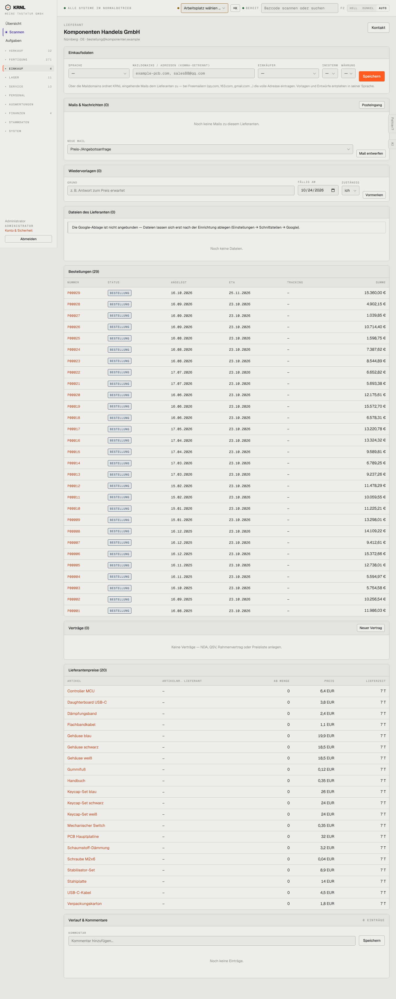

# 471-lieferant — Lieferantenakte

- **Bereich:** Einkauf
- **Route:** `/einkauf/lieferanten/fc150acc-f35e-47d4-ad63-55beff6db61e`
- **Note:** 3 / 5
- **Zweck:** Lieferantenakte: Einkaufsdaten, Mails, Dateien, Bestellungen
- **Messwerte:** HTTP 200 · Ladezeit 772 ms · Seitenhöhe 3632 px · horizontaler Überlauf nein · Texte < 11 px: 65

## Was gut ist

- Erklärung zu Freemailer-Domains
- Alle Bestellungen des Lieferanten

## Befunde

| Schwere | Kategorie | Befund | Vorschlag |
|---|---|---|---|
| **mittel** | Eingabe | Platzhalter ‚example-pcb.com, sales88@qq.com‘ im Maildomain-Feld sieht wie gespeicherter Wert aus. | Platzhalter heller und mit ‚z. B.‘. |
| **mittel** | Status | Bestellliste zeigt wieder nur ‚BESTELLUNG‘ (Belegart) statt Liefer-/Rechnungsstatus; 29 Zeilen ohne Seitenaufteilung. | Wie 401. |
| **niedrig** | Daten | Keine Kennzahlen (Umsatz/Jahr, Liefertreue, Ø Lieferzeit). | Kennzahlenleiste im Kopf. |

[← zur Übersicht](../README.md)
