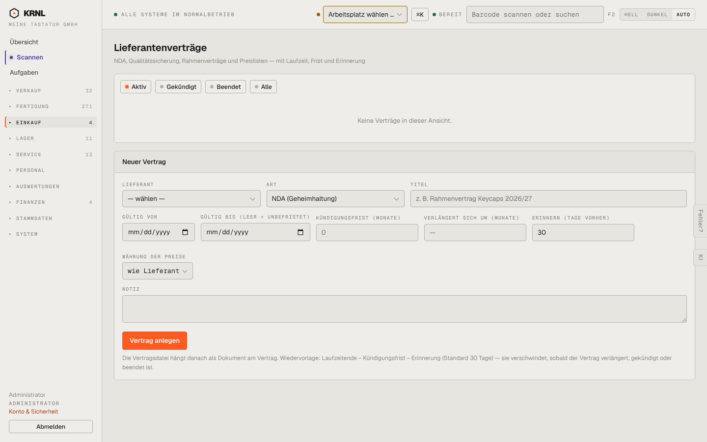

# 480-vertraege — Lieferantenverträge

- **Bereich:** Einkauf
- **Route:** `/einkauf/vertraege`
- **Note:** 3 / 5
- **Zweck:** Lieferantenverträge mit Laufzeit, Frist, Erinnerung
- **Messwerte:** HTTP 200 · Ladezeit 775 ms · Seitenhöhe 900 px · horizontaler Überlauf nein · Texte < 11 px: 23

## Was gut ist

- Erklärung der automatischen Wiedervorlage vor Kündigungsfrist

## Befunde

| Schwere | Kategorie | Befund | Vorschlag |
|---|---|---|---|
| **niedrig** | Eingabe | Kündigungsfrist zeigt ‚0‘ als Platzhalter – wirkt wie Wert; Datumsfelder US-Format. | Leeres Feld mit ‚z. B. 3‘. |
| **niedrig** | Layout | Formular dominiert die (leere) Seite. | Knopf ‚Neuer Vertrag‘ + Dialog. |

[← zur Übersicht](../README.md)
