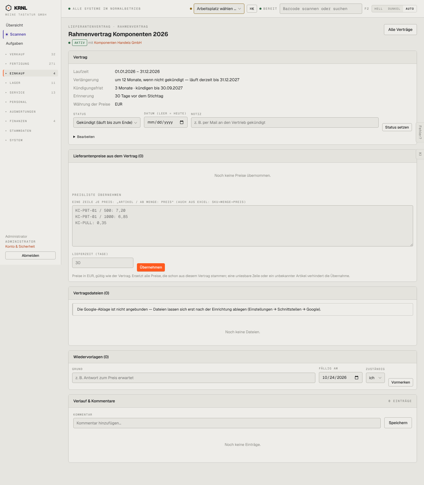

# 481-vertrag — Lieferantenvertrag

- **Bereich:** Einkauf
- **Route:** `/einkauf/vertraege/f036deed-78df-49a2-a861-877d988b7aa1`
- **Note:** 3 / 5
- **Zweck:** Lieferantenvertrag mit Laufzeit, Verlängerung, Frist, Preisliste
- **Messwerte:** HTTP 200 · Ladezeit 774 ms · Seitenhöhe 1649 px · horizontaler Überlauf nein · Texte < 11 px: 35

## Was gut ist

- Laufzeitlogik ausformuliert (‚läuft derzeit bis 31.12.2027 · kündigen bis 30.09.2027‘)
- Preisliste per Einfügen aus Excel

## Befunde

| Schwere | Kategorie | Befund | Vorschlag |
|---|---|---|---|
| **mittel** | Eingabe | Status-Auswahl steht auf ‚Gekündigt (läuft bis zum Ende)‘, obwohl der Vertrag ‚AKTIV‘ ist – ein Klick auf ‚Status setzen‘ kündigt ungewollt. | Aktuellen Status vorbelegen; Kündigen als eigene, bestätigte Aktion. |
| **mittel** | Eingabe | Preisliste als Freitext-Syntax ‚ARTIKEL / AB MENGE: PREIS‘ mit Platzhaltern, die wie Inhalt aussehen. | Tabelle zum Einfügen mit Vorschau/Validierung je Zeile. |
| **niedrig** | Eingabe | Datumsfelder US-Format. | de-DE. |

[← zur Übersicht](../README.md)
