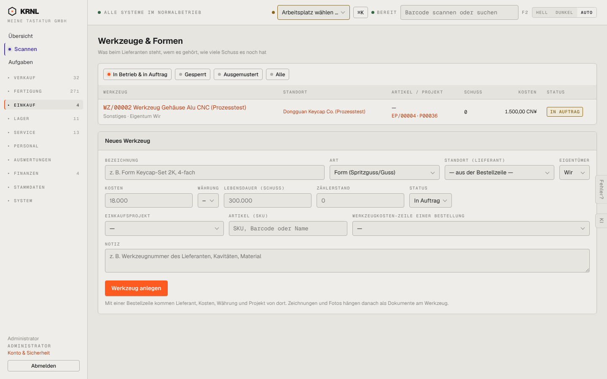

# 490-werkzeuge — Werkzeuge & Formen

- **Bereich:** Einkauf
- **Route:** `/einkauf/werkzeuge`
- **Note:** 3 / 5
- **Zweck:** Werkzeuge & Formen beim Lieferanten
- **Messwerte:** HTTP 200 · Ladezeit 762 ms · Seitenhöhe 900 px · horizontaler Überlauf nein · Texte < 11 px: 33

## Was gut ist

- Schusszähler, Eigentum, Projektbezug

## Befunde

| Schwere | Kategorie | Befund | Vorschlag |
|---|---|---|---|
| **niedrig** | Texte | ‚Eigentum Wir‘ / Auswahl ‚Wir‘ – holprig. | ‚Eigentum: eigenes‘ / ‚Lieferant‘. |
| **niedrig** | Eingabe | Platzhalter ‚18.000‘ und ‚300.000‘ sehen wie Werte aus. | ‚z. B. …‘. |

[← zur Übersicht](../README.md)
