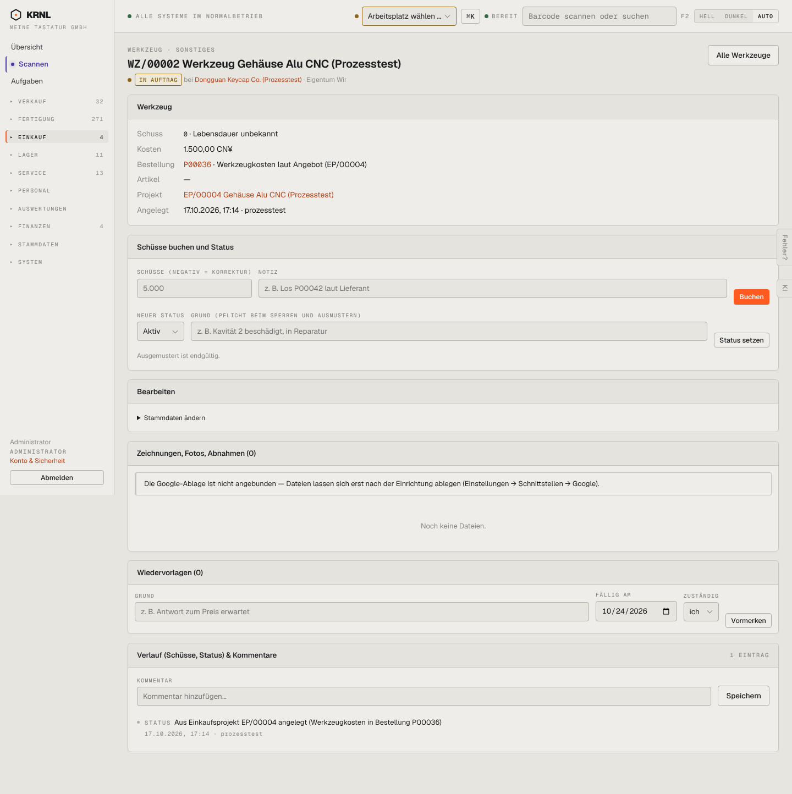

# 491-werkzeug — Werkzeug Detail

- **Bereich:** Einkauf
- **Route:** `/einkauf/werkzeuge/6855229d-8aa5-42b9-bbbc-cd453c9f83b6`
- **Note:** 3 / 5
- **Zweck:** Werkzeugakte: Schüsse buchen, Status
- **Messwerte:** HTTP 200 · Ladezeit 784 ms · Seitenhöhe 1444 px · horizontaler Überlauf nein · Texte < 11 px: 36

## Was gut ist

- Schussbuchung mit Korrektur
- Grund-Pflicht beim Sperren/Ausmustern

## Befunde

| Schwere | Kategorie | Befund | Vorschlag |
|---|---|---|---|
| **niedrig** | Logik | ‚Neuer Status‘ steht auf ‚Aktiv‘ vorbelegt, aktueller Zustand ist ‚In Auftrag‘ – ein Klick ändert ungewollt. | Aktuellen Status vorbelegen. |

[← zur Übersicht](../README.md)
