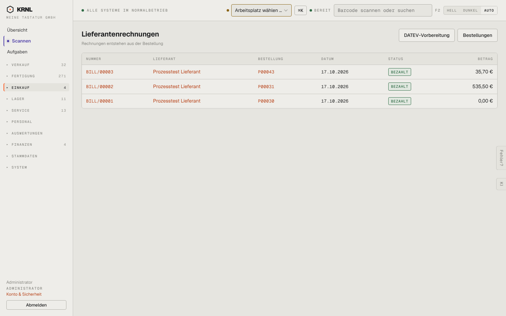

# 495-rechnungen — Lieferantenrechnungen

- **Bereich:** Einkauf
- **Route:** `/einkauf/rechnungen`
- **Note:** 3 / 5
- **Zweck:** Lieferantenrechnungen
- **Messwerte:** HTTP 200 · Ladezeit 786 ms · Seitenhöhe 900 px · horizontaler Überlauf nein · Texte < 11 px: 22

## Was gut ist

- Verknüpfung zur Bestellung

## Befunde

| Schwere | Kategorie | Befund | Vorschlag |
|---|---|---|---|
| **mittel** | Filter | Keine Filter (offen/fällig/bezahlt), keine Summen; nur 3 Rechnungen, obwohl 27 Bestellungen ‚Rechnung erwartet‘. | Filter + Hinweis ‚27 Bestellungen warten auf Rechnung‘. |
| **niedrig** | Texte | Englisches Präfix ‚BILL/‘ in deutscher Oberfläche. | ‚ER/‘ (Eingangsrechnung). |

[← zur Übersicht](../README.md)
