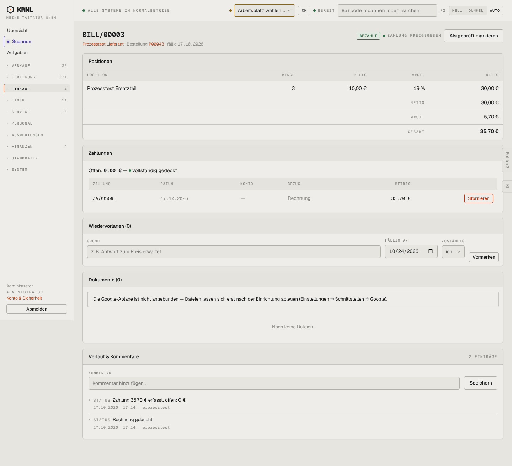

# 496-rechnung-bezahlt — Lieferantenrechnung bezahlt

- **Bereich:** Einkauf
- **Route:** `/einkauf/rechnungen/2cbcc1c5-ed66-4c01-b30e-9909b98981a3`
- **Note:** 3 / 5
- **Zweck:** Bezahlte Lieferantenrechnung
- **Messwerte:** HTTP 200 · Ladezeit 768 ms · Seitenhöhe 1310 px · horizontaler Überlauf nein · Texte < 11 px: 37

## Was gut ist

- Zahlungen mit Offen-Betrag
- Status ‚Zahlung freigegeben‘

## Befunde

| Schwere | Kategorie | Befund | Vorschlag |
|---|---|---|---|
| **hoch** | Logik | Rechnung ist bezahlt und ‚Zahlung freigegeben‘, aber noch nicht geprüft (‚Als geprüft markieren‘) – Prüfung nach Zahlung. | Reihenfolge erzwingen: prüfen → freigeben → zahlen. |
| **niedrig** | Texte | Verlauf ‚Zahlung 35.70 € erfasst‘ mit Dezimalpunkt. | Deutsches Zahlenformat. |

[← zur Übersicht](../README.md)
