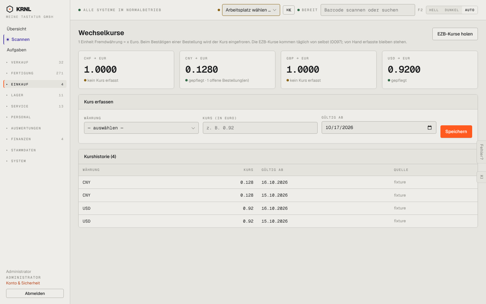

# 497-kurse — Wechselkurse

- **Bereich:** Einkauf
- **Route:** `/einkauf/kurse`
- **Note:** 2 / 5
- **Zweck:** Wechselkurse (EZB + manuell)
- **Messwerte:** HTTP 200 · Ladezeit 772 ms · Seitenhöhe 900 px · horizontaler Überlauf nein · Texte < 11 px: 24

## Was gut ist

- Kurse als Kacheln, eingefroren je Bestellung erklärt
- Historie mit Quelle

## Befunde

| Schwere | Kategorie | Befund | Vorschlag |
|---|---|---|---|
| **hoch** | Daten | CHF und GBP zeigen ‚1.0000 – kein Kurs erfasst‘: ein fehlender Kurs wird als 1:1 dargestellt (und ggf. gerechnet). | Fehlenden Kurs als ‚—‘ + Warnung; Bestellungen in dieser Währung blockieren. |
| **mittel** | Typografie | Kurse mit Dezimalpunkt (0.1280, 0.128) statt Komma; unterschiedliche Stellenzahl in Kachel und Historie. | de-DE, einheitlich 4 Stellen. |
| **niedrig** | Texte | Quelle ‚fixture‘ und Migrationsnummer ‚(0097)‘ im Untertitel – Entwicklerbegriffe. | ‚Testdaten‘/‚EZB‘/‚von Hand‘. |

[← zur Übersicht](../README.md)
