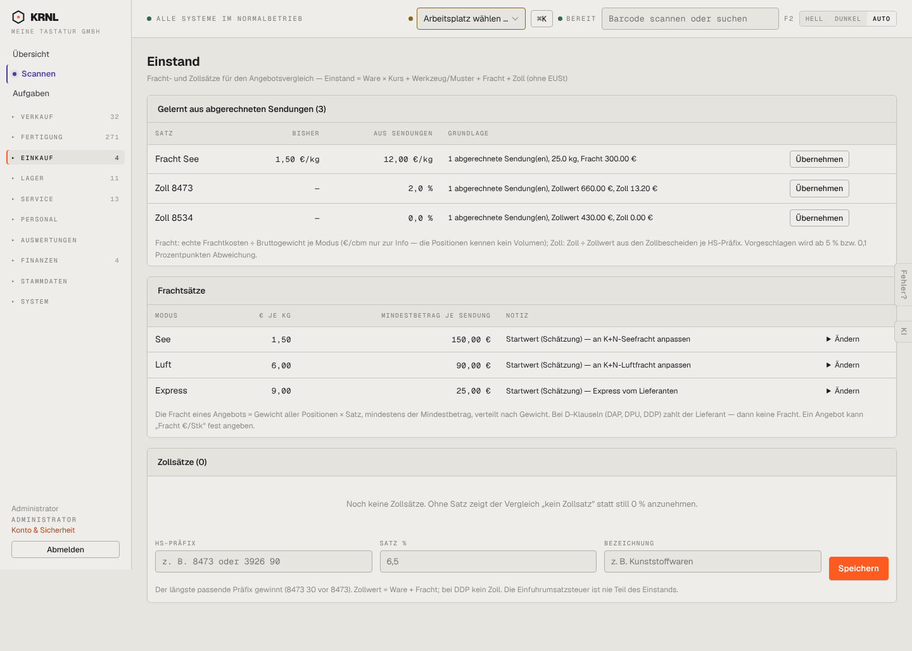

# 498-einstand — Einstand (Fracht & Zoll)

- **Bereich:** Einkauf
- **Route:** `/einkauf/einstand`
- **Note:** 3 / 5
- **Zweck:** Fracht- und Zollsätze für den Einstand
- **Messwerte:** HTTP 200 · Ladezeit 709 ms · Seitenhöhe 1029 px · horizontaler Überlauf nein · Texte < 11 px: 33

## Was gut ist

- Sätze ‚gelernt aus abgerechneten Sendungen‘ mit Übernehmen
- Erklärungen zu Formel und Präfix-Regel

## Befunde

| Schwere | Kategorie | Befund | Vorschlag |
|---|---|---|---|
| **mittel** | Typografie | Grundlage-Texte mischen Formate (‚25.0 kg, Fracht 300.00 €‘ mit Punkt). | de-DE-Formatierung. |
| **niedrig** | Texte | ‚1 abgerechnete Sendung(en)‘ – Klammer-Plural; Fachbegriffe (D-Klauseln, DDP) ohne Erklärung. | Plural auflösen, Tooltips. |

[← zur Übersicht](../README.md)
