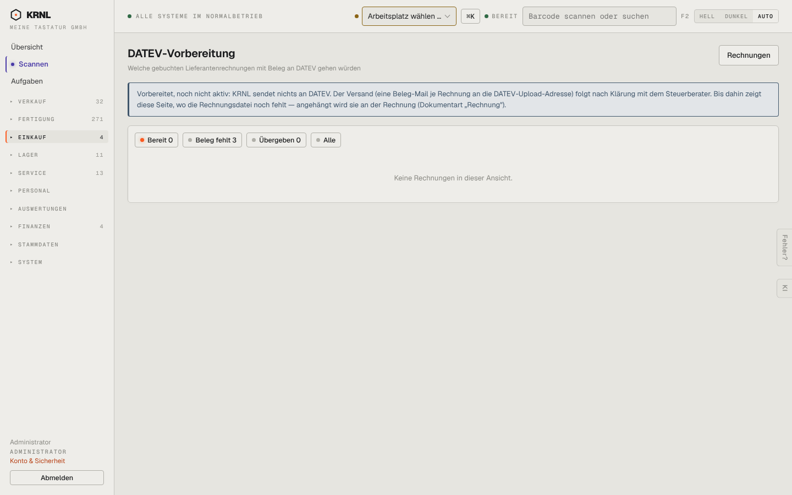

# 499-datev — DATEV (Einkauf)

- **Bereich:** Einkauf
- **Route:** `/einkauf/datev`
- **Note:** 3 / 5
- **Zweck:** DATEV-Vorbereitung Lieferantenrechnungen (noch nicht aktiv)
- **Messwerte:** HTTP 200 · Ladezeit 776 ms · Seitenhöhe 900 px · horizontaler Überlauf nein · Texte < 11 px: 13

## Was gut ist

- Klarer Hinweis ‚Vorbereitet, noch nicht aktiv‘

## Befunde

| Schwere | Kategorie | Befund | Vorschlag |
|---|---|---|---|
| **niedrig** | Filter | Standardfilter ‚Bereit 0‘ zeigt leere Seite, obwohl ‚Beleg fehlt 3‘ der eigentliche Handlungsbedarf ist. | Standard auf ‚Beleg fehlt‘, wenn Bereit leer. |
| **niedrig** | Navigation | Buchhaltung ist laut Betreiber auf Hold – Menüpunkt dennoch sichtbar. | Ausblenden/als ‚in Vorbereitung‘ gruppieren. |

[← zur Übersicht](../README.md)
