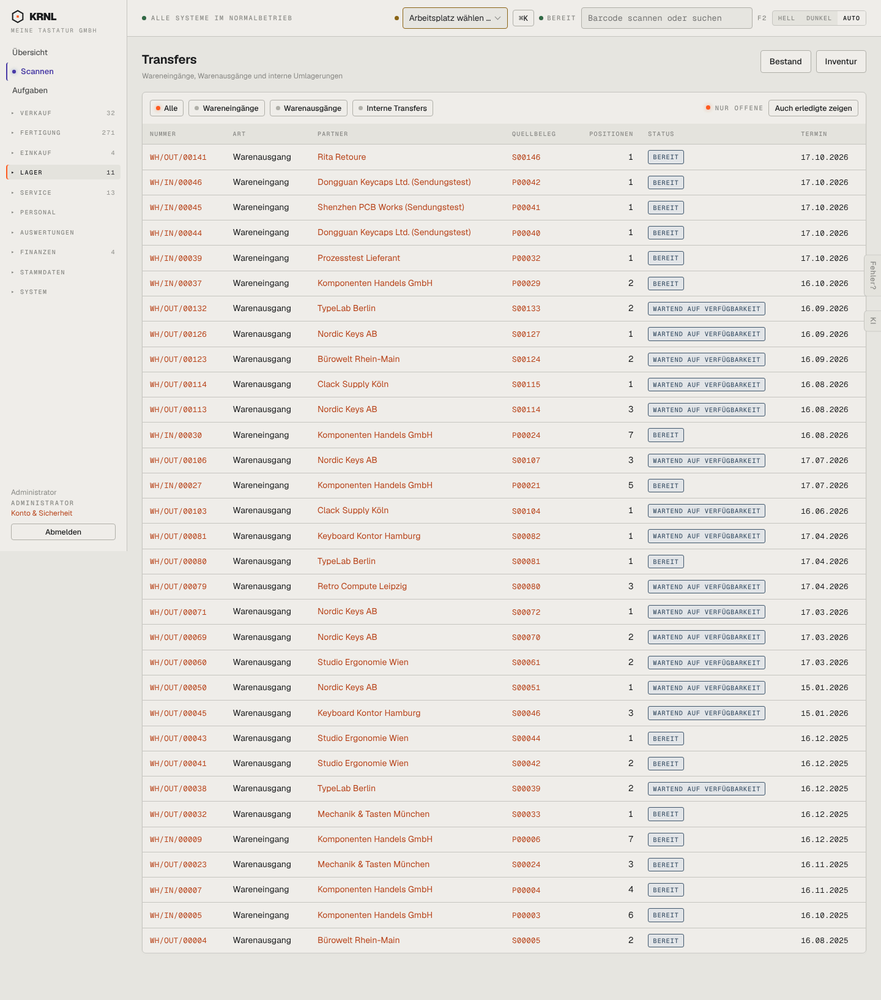

# 500-transfers — Transfers

- **Bereich:** Lager
- **Route:** `/lager`
- **Note:** 3 / 5
- **Zweck:** Alle Lagerbewegungen (Eingänge, Ausgänge, Umlagerungen)
- **Messwerte:** HTTP 200 · Ladezeit 1115 ms · Seitenhöhe 1633 px · horizontaler Überlauf nein · Texte < 11 px: 52

## Was gut ist

- Filter nach Art + ‚nur offene‘
- Quellbeleg je Zeile verlinkt

## Befunde

| Schwere | Kategorie | Befund | Vorschlag |
|---|---|---|---|
| **hoch** | Status | Offene Wareneingänge mit Termin 16.10.2025 (ein Jahr alt) stehen als ‚BEREIT‘ ohne Überfällig-Kennzeichnung neben aktuellen. | Überfällige Termine rot, Sortierung ‚überfällig zuerst‘, Filter. |
| **mittel** | Filter | Schalter ‚NUR OFFENE‘ (Punkt) und Knopf ‚Auch erledigte zeigen‘ beschreiben denselben Filter doppelt. | Ein Umschalter offen/alle. |
| **niedrig** | Status | Langes Etikett ‚WARTEND AUF VERFÜGBARKEIT‘ dominiert die Tabelle. | Kurz ‚Wartet auf Ware‘ (Tooltip mit Details). |

[← zur Übersicht](../README.md)
