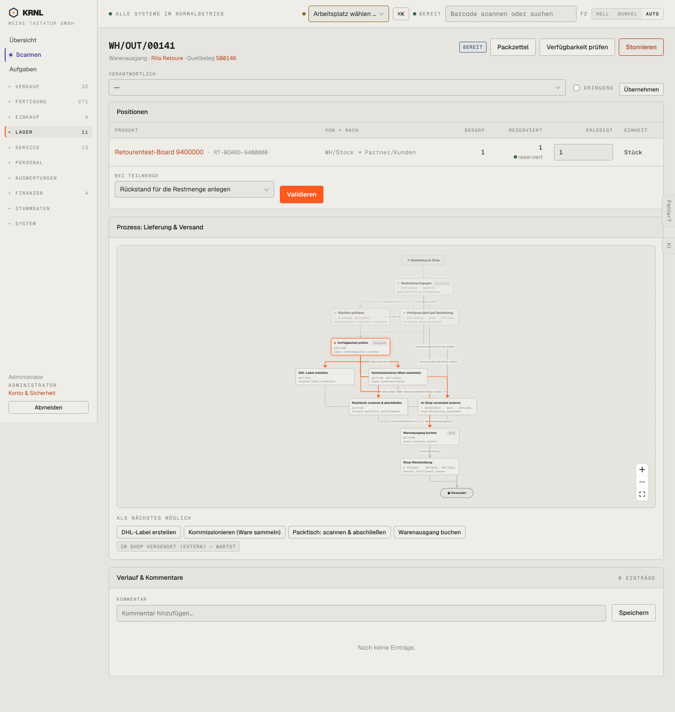

# 501-lieferung-bereit — Lieferung bereit

- **Bereich:** Lager
- **Route:** `/lager/965d2049-9eac-4716-af8a-d0bbd9101dc1`
- **Note:** 3 / 5
- **Zweck:** Versandbereite Lieferung buchen
- **Messwerte:** HTTP 200 · Ladezeit 948 ms · Seitenhöhe 1518 px · horizontaler Überlauf nein · Texte < 11 px: 72

## Was gut ist

- Reservierung je Position sichtbar
- Prozess-Panel mit nächsten Schritten

## Befunde

| Schwere | Kategorie | Befund | Vorschlag |
|---|---|---|---|
| **mittel** | Texte | Knopf ‚Validieren‘ (Odoo-Begriff) für das Buchen des Warenausgangs. | ‚Warenausgang buchen‘. |
| **mittel** | Schritte | Vier nächste Schritte gleichrangig (DHL-Label, Kommissionieren, Packtisch, Warenausgang buchen) plus orange ‚Validieren‘ oben – zwei Wege zum selben Ziel. | Empfohlenen Weg (Kommissionieren → Packtisch) hervorheben, ‚Validieren‘ als Notweg. |
| **niedrig** | Texte | Diagrammknoten zeigen englische Zustandscodes (confirmed, assigned, done). | Deutsche Bezeichnungen. |

[← zur Übersicht](../README.md)
