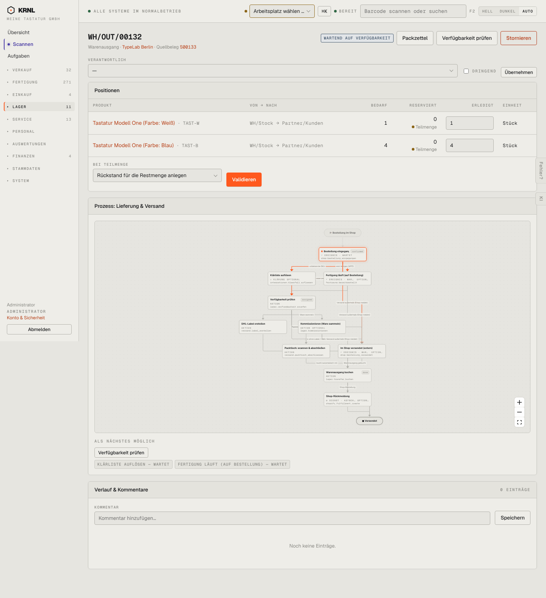

# 502-lieferung-wartet — Lieferung wartet

- **Bereich:** Lager
- **Route:** `/lager/ce846d9b-c0a3-4b94-836c-2b6683e2ac89`
- **Note:** 2 / 5
- **Zweck:** Lieferung wartet auf Verfügbarkeit
- **Messwerte:** HTTP 200 · Ladezeit 960 ms · Seitenhöhe 1577 px · horizontaler Überlauf nein · Texte < 11 px: 73

## Was gut ist

- ‚Teilmenge‘-Hinweis je Position
- Wartende Ereignisse (Klärliste, Fertigung) sichtbar

## Befunde

| Schwere | Kategorie | Befund | Vorschlag |
|---|---|---|---|
| **kritisch** | Logik | Feld ‚Erledigt‘ ist mit der vollen Bedarfsmenge (1 bzw. 4) vorbelegt, obwohl 0 reserviert sind – ‚Validieren‘ ist aktiv und würde Ware ausbuchen, die nicht da ist (negativer Bestand, vgl. 520). | Erledigt-Menge = reservierte Menge vorbelegen; Buchen über Bestand nur mit ausdrücklicher Bestätigung. |
| **mittel** | Schritte | Diagramm markiert ‚Bestellung eingegangen‘ als aktuellen Schritt, der Kopf ‚Wartend auf Verfügbarkeit‘ – zwei Aussagen. | Aktueller Schritt = ‚Fertigung läuft‘. |

[← zur Übersicht](../README.md)
