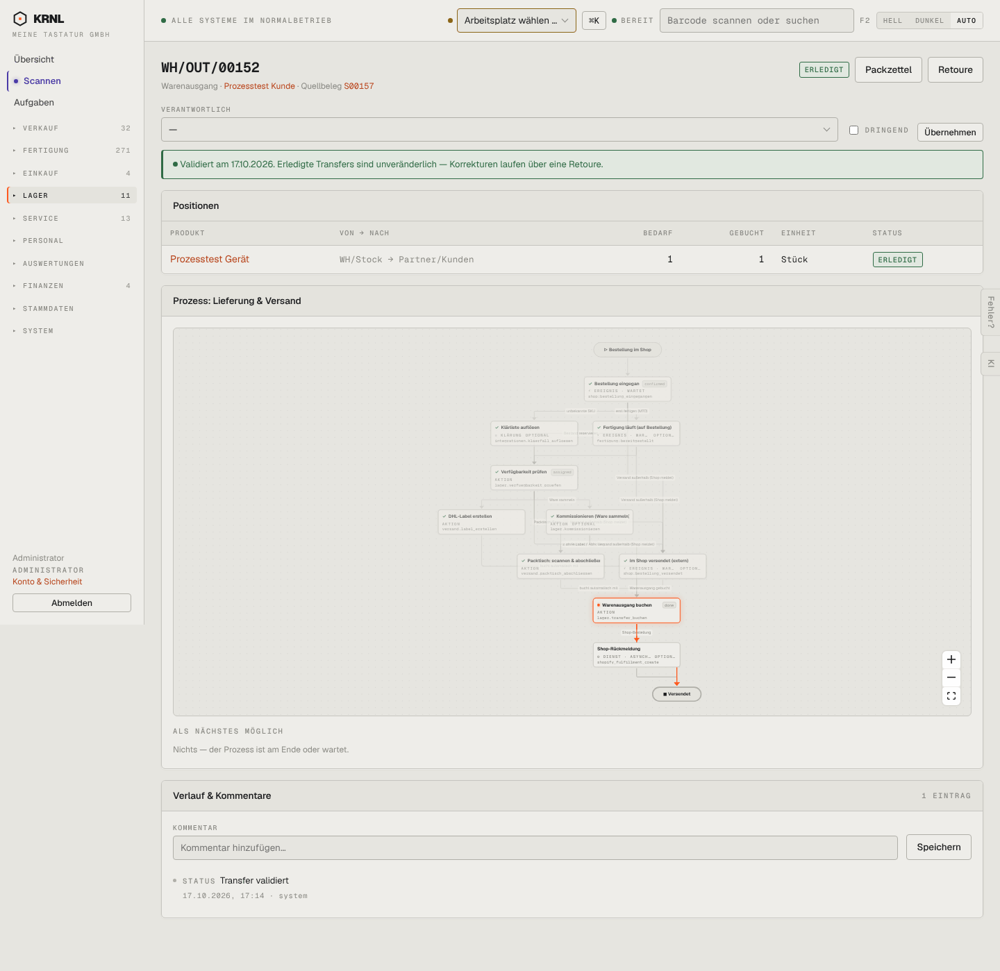

# 503-lieferung-erledigt — Lieferung erledigt

- **Bereich:** Lager
- **Route:** `/lager/06fb02ad-95ae-4ec4-b0e2-b64ed72deb44`
- **Note:** 3 / 5
- **Zweck:** Erledigte Lieferung
- **Messwerte:** HTTP 200 · Ladezeit 913 ms · Seitenhöhe 1399 px · horizontaler Überlauf nein · Texte < 11 px: 73

## Was gut ist

- Banner ‚Erledigte Transfers sind unveränderlich — Korrekturen über eine Retoure‘

## Befunde

| Schwere | Kategorie | Befund | Vorschlag |
|---|---|---|---|
| **mittel** | Konsistenz | Knopf ‚Retoure‘ (Lager-Rückbuchung) kollidiert begrifflich mit dem neuen Retourenprozess (nur Shop-Aufträge) – hier ein Firmenkunde. | Lager-Rückbuchung ‚Rücklieferung buchen‘ nennen; ‚Retoure‘ nur für den Prozess. |
| **niedrig** | Logik | Verantwortlich/Dringend/Übernehmen bei erledigtem Transfer editierbar. | Schreibschutz. |

[← zur Übersicht](../README.md)
