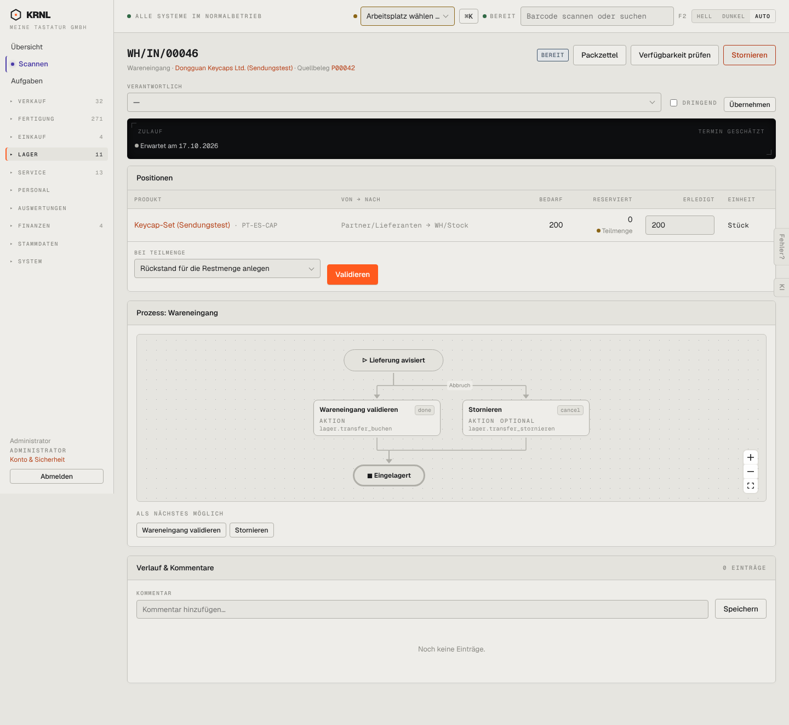

# 504-wareneingang-bereit — Wareneingang bereit

- **Bereich:** Lager
- **Route:** `/lager/5227afa1-17ba-4ca2-b22a-5450d998def2`
- **Note:** 3 / 5
- **Zweck:** Wareneingang buchen
- **Messwerte:** HTTP 200 · Ladezeit 801 ms · Seitenhöhe 1322 px · horizontaler Überlauf nein · Texte < 11 px: 36

## Was gut ist

- Zulauf-Karte mit erwartetem Termin
- Einfaches Prozessbild (validieren/stornieren)

## Befunde

| Schwere | Kategorie | Befund | Vorschlag |
|---|---|---|---|
| **mittel** | Konsistenz | Knöpfe ‚Packzettel‘ und ‚Verfügbarkeit prüfen‘ sowie Spalte ‚Reserviert 0 · Teilmenge‘ auf einem Wareneingang sinnlos. | Aktionen/Spalten je Transferart. |
| **mittel** | Eingabe | ‚Erledigt‘ mit 200 vorbelegt – Eingang wird ohne Zählen gebucht. | Leer lassen oder Scan-Zählung erzwingen (Scan-Pflicht-Einstellung). |

[← zur Übersicht](../README.md)
