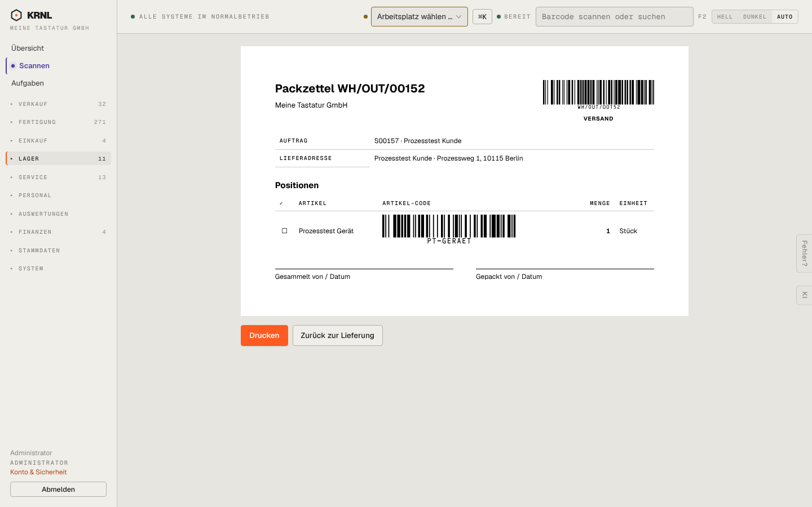

# 505-transfer-druck — Lieferschein (Druck)

- **Bereich:** Lager
- **Route:** `/lager/06fb02ad-95ae-4ec4-b0e2-b64ed72deb44/druck`
- **Note:** 4 / 5
- **Zweck:** Packzettel eines Transfers
- **Messwerte:** HTTP 200 · Ladezeit 737 ms · Seitenhöhe 900 px · horizontaler Überlauf nein · Texte < 11 px: 20

## Was gut ist

- Wie Sammeldruck, mit ‚Zurück zur Lieferung‘

## Befunde

| Schwere | Kategorie | Befund | Vorschlag |
|---|---|---|---|
| **niedrig** | Daten | Kein Lagerplatz je Position. | Siehe 201. |

[← zur Übersicht](../README.md)
