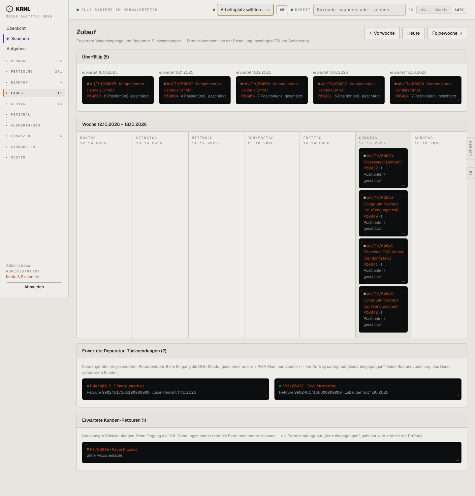

# 510-zulauf — Zulauf

- **Bereich:** Lager
- **Route:** `/lager/zulauf`
- **Note:** 3 / 5
- **Zweck:** Erwartete Eingänge als Wochenkalender + Reparatur- und Kunden-Retouren
- **Messwerte:** HTTP 200 · Ladezeit 845 ms · Seitenhöhe 1502 px · horizontaler Überlauf nein · Texte < 11 px: 20

## Was gut ist

- Wochenansicht mit Vor/Folgewoche
- Überfällig-Bereich oben
- Erwartete Reparatur- und Kunden-Retouren mit Scan-Hinweis

## Befunde

| Schwere | Kategorie | Befund | Vorschlag |
|---|---|---|---|
| **mittel** | Logik | Überfällige Eingänge seit 16.10.2025 werden weiter ‚erwartet‘ – nach einem Jahr ist das kein Zulauf mehr. | Ab X Tagen Eskalation ‚beim Lieferanten nachfragen / stornieren‘. |
| **mittel** | Layout | Schwarze Karten in schmalen Tagesspalten umbrechen jede Zeile (Lieferant, Bestellung, ‚1 Position(en) · geschätzt‘) – schwer lesbar; Mo–Fr leer, alles am Samstag. | Helle kompakte Karten, Tageszähler, Listenansicht als Alternative. |
| **niedrig** | Status | RT/00005 ‚ohne Retourenlabel‘ – Handlungsbedarf nur als grauer Text. | Warnfarbe + Link ‚Label senden‘. |

[← zur Übersicht](../README.md)
