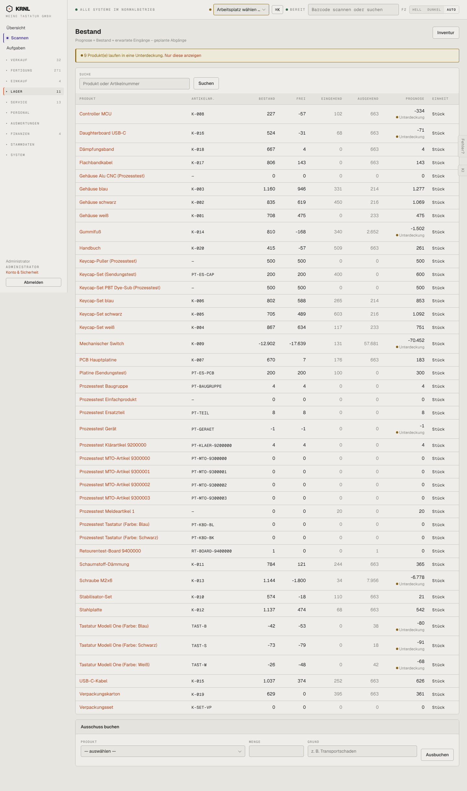

# 520-bestand — Bestand

- **Bereich:** Lager
- **Route:** `/lager/bestand`
- **Note:** 2 / 5
- **Zweck:** Bestand je Produkt mit Prognose
- **Messwerte:** HTTP 200 · Ladezeit 912 ms · Seitenhöhe 2434 px · horizontaler Überlauf nein · Texte < 11 px: 25

## Was gut ist

- Banner ‚9 Produkte laufen in eine Unterdeckung — Nur diese anzeigen‘
- Spalten frei/eingehend/ausgehend/Prognose

## Befunde

| Schwere | Kategorie | Befund | Vorschlag |
|---|---|---|---|
| **kritisch** | Daten | Physischer Bestand ist negativ (Mechanischer Switch −12.902, Tastatur Blau −42, Prozesstest Gerät −1) – ohne Alarm; nur die Prognose bekommt ‚Unterdeckung‘. | Negativen Bestand als Fehler (rot) markieren, Ursache verlinken; Buchungen ins Negative verhindern oder bestätigen lassen. |
| **mittel** | Leistung | Alle Produkte in einer Liste, keine Gruppierung (Komponenten/Fertigware), keine Lagerorte (WH/B-Ware fehlt als Spalte). | Filter nach Kategorie/Lagerort; Spalte B-Ware. |
| **niedrig** | Layout | ‚Ausschuss buchen‘ als Formular am Seitenende – selten, aber destruktiv. | Als Aktion je Produktzeile mit Dialog. |

[← zur Übersicht](../README.md)
