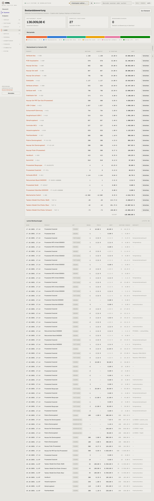

# 530-bewertung — Bewertung

- **Bereich:** Lager
- **Route:** `/lager/bewertung`
- **Note:** 3 / 5
- **Zweck:** Bestandsbewertung (gleitender Durchschnitt) und Bewegungsjournal
- **Messwerte:** HTTP 200 · Ladezeit 898 ms · Seitenhöhe 4666 px · horizontaler Überlauf nein · Texte < 11 px: 91

## Was gut ist

- Gesamtwert, Anteile, Wert je Variante
- Journal mit Nebenkosten (Landed Costs)

## Befunde

| Schwere | Kategorie | Befund | Vorschlag |
|---|---|---|---|
| **hoch** | Daten | ‚Mengenabweichungen 0 — Bestand und Bewertung im Gleichlauf‘, obwohl negative Bestände existieren (Prozesstest Gerät −1 mit Wert 0,00 €, Switch −12.902 fehlt in der Liste). | Negative Bestände als Abweichung zählen und anzeigen. |
| **mittel** | Konsistenz | Wertanteil-Balken in sechs grellen Farben außerhalb der Gestaltungspalette. | Palette aus Design-Tokens (Akzent + Abstufungen). |
| **niedrig** | Texte | Journal zeigt Codes ‚customs_duty‘, ‚freight‘; Zugänge mit Preis ‚—‘ (0 €). | Deutsche Bezeichnungen; Nullpreis-Zugänge markieren. |
| **niedrig** | Funktion | ‚Schichten‘-Knopf in jeder Zeile ohne Erklärung. | ‚Bewertungsschichten anzeigen‘ als Tooltip/Aufklapper. |

[← zur Übersicht](../README.md)
