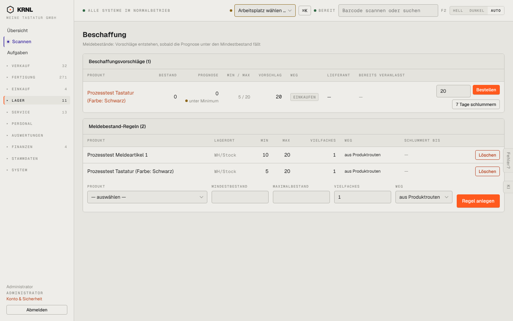

# 540-beschaffung — Beschaffung

- **Bereich:** Lager
- **Route:** `/lager/beschaffung`
- **Note:** 2 / 5
- **Zweck:** Beschaffungsvorschläge aus Meldebeständen
- **Messwerte:** HTTP 200 · Ladezeit 756 ms · Seitenhöhe 900 px · horizontaler Überlauf nein · Texte < 11 px: 34

## Was gut ist

- Vorschlag mit Menge, Bestellen und ‚7 Tage schlummern‘

## Befunde

| Schwere | Kategorie | Befund | Vorschlag |
|---|---|---|---|
| **hoch** | Logik | Nur 1 Vorschlag (Testartikel), während der Bestand 9 Produkte in Unterdeckung zeigt (Switch −70.452 Prognose): Komponenten ohne Meldebestand-Regel erzeugen nie einen Vorschlag. | Vorschläge auch aus Unterdeckung (Bedarf aus Fertigung) – oder Hinweis ‚9 Produkte in Unterdeckung ohne Regel‘. |
| **mittel** | Logik | Vorschlag ohne Lieferant (‚—‘) bietet trotzdem ‚Bestellen‘ an. | Lieferant wählen erzwingen. |

[← zur Übersicht](../README.md)
