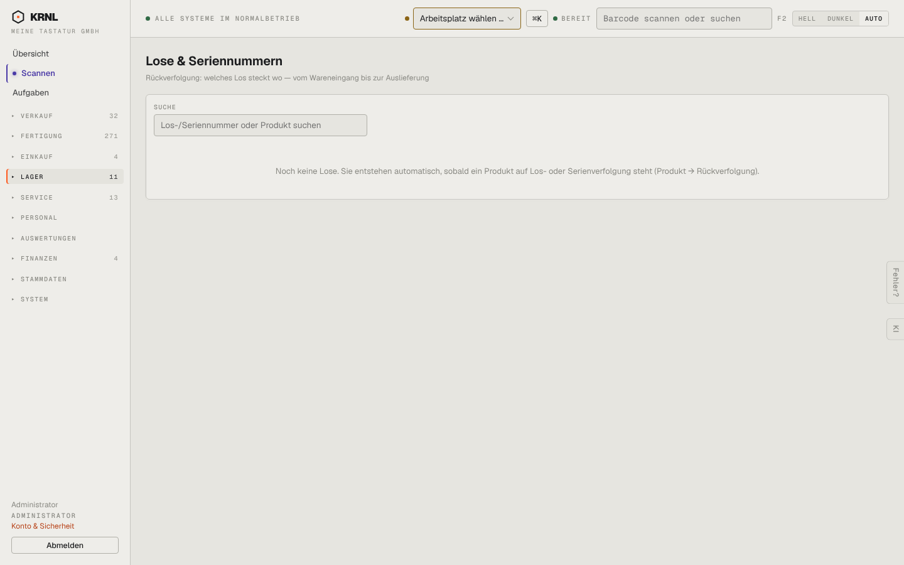

# 550-lose — Lose & Serien

- **Bereich:** Lager
- **Route:** `/lager/lose`
- **Note:** 4 / 5
- **Zweck:** Los- und Seriennummern-Rückverfolgung
- **Messwerte:** HTTP 200 · Ladezeit 717 ms · Seitenhöhe 900 px · horizontaler Überlauf nein · Texte < 11 px: 14

## Was gut ist

- Leerzustand erklärt, wie Lose entstehen

## Befunde

| Schwere | Kategorie | Befund | Vorschlag |
|---|---|---|---|
| **niedrig** | Navigation | Menüpunkt ohne Inhalt, solange kein Produkt auf Verfolgung steht. | Ausblenden, bis die Funktion genutzt wird (Chamäleon-Prinzip). |

[← zur Übersicht](../README.md)
