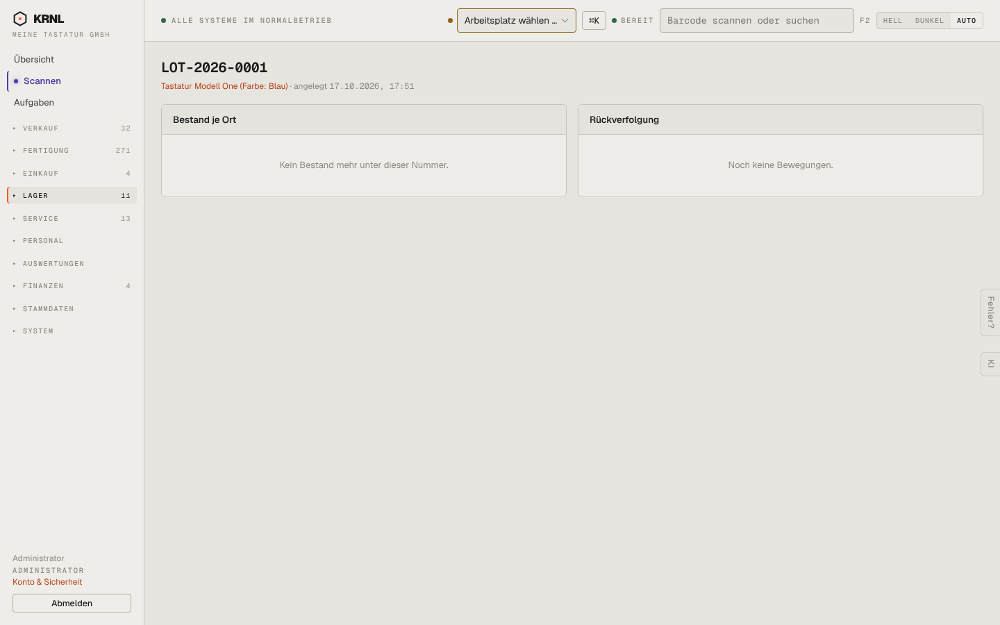

# 551-los — Los / Seriennummer

- **Bereich:** Lager
- **Route:** `/lager/lose/c9cffe5b-d524-458c-a1c4-81f9d5dddfb1`
- **Note:** 3 / 5
- **Zweck:** Los/Seriennummer: Bestand je Ort und Rückverfolgung
- **Messwerte:** HTTP 200 · Ladezeit 830 ms · Seitenhöhe 900 px · horizontaler Überlauf nein · Texte < 11 px: 13

## Was gut ist

- Klare zweigeteilte Ansicht

## Befunde

| Schwere | Kategorie | Befund | Vorschlag |
|---|---|---|---|
| **niedrig** | Funktion | Keine Verknüpfung zu Kundenaufträgen/Reparaturen/Retouren, in denen das Los vorkam (Rückverfolgung nur Bewegungen). | Zeitleiste: Eingang → Fertigung → Lieferung an Kunde X → Retoure. |

[← zur Übersicht](../README.md)
