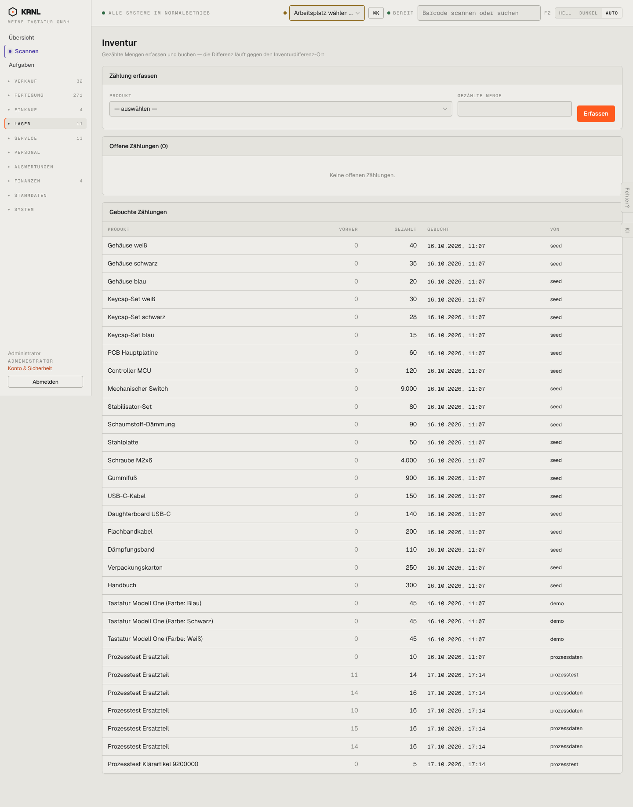

# 560-inventur — Inventur

- **Bereich:** Lager
- **Route:** `/lager/inventur`
- **Note:** 3 / 5
- **Zweck:** Zählungen erfassen und buchen
- **Messwerte:** HTTP 200 · Ladezeit 741 ms · Seitenhöhe 1836 px · horizontaler Überlauf nein · Texte < 11 px: 20

## Was gut ist

- Offene vs. gebuchte Zählungen
- Wer gezählt hat

## Befunde

| Schwere | Kategorie | Befund | Vorschlag |
|---|---|---|---|
| **mittel** | Funktion | Zählung nur einzeln je Produkt, ohne Lagerort, ohne Zählliste/Scan-Modus; Differenz nicht als eigene Spalte. | Zählliste je Lagerort, Scan-Erfassung, Spalte Differenz (+/−) farbig. |
| **niedrig** | Texte | ‚Von‘ zeigt technische Quellen (seed, prozessdaten). | Benutzername bzw. ‚System (Testdaten)‘. |

[← zur Übersicht](../README.md)
