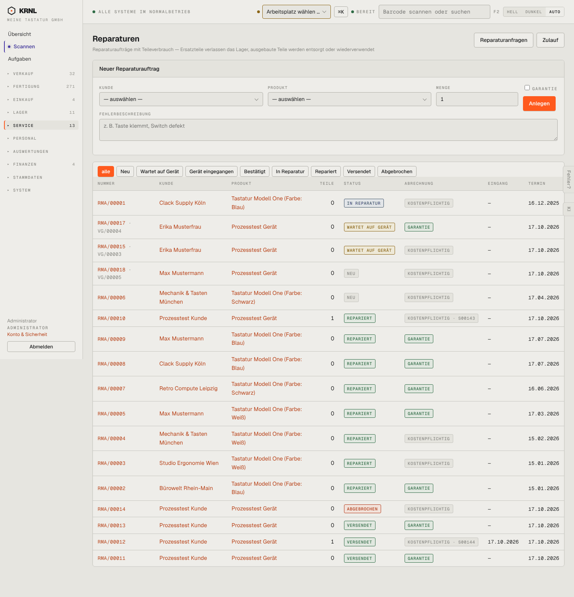

# 600-reparaturen — Reparaturen

- **Bereich:** Service
- **Route:** `/reparatur`
- **Note:** 3 / 5
- **Zweck:** Alle Reparaturaufträge (RMA) mit Status und Abrechnung
- **Messwerte:** HTTP 200 · Ladezeit 972 ms · Seitenhöhe 1496 px · horizontaler Überlauf nein · Texte < 11 px: 60

## Was gut ist

- Statusfilter entlang des Ablaufs
- Garantie/kostenpflichtig sichtbar, Verknüpfung zu Anfrage (VG) und Angebot (S…)

## Befunde

| Schwere | Kategorie | Befund | Vorschlag |
|---|---|---|---|
| **hoch** | Status | RMA/00001 ‚In Reparatur‘ seit 16.12.2025 und neun ‚Repariert‘-Aufträge seit Monaten nicht zurückgesendet – keine Kennzeichnung von Liegezeit/Überfälligkeit. | Spalte ‚seit‘ + Warnfarbe ab X Tagen; Filter ‚hängt‘. |
| **mittel** | Daten | Spalte ‚Eingang‘ fast überall ‚—‘, auch bei reparierten/versendeten Geräten (die eingegangen sein müssen). | Eingangsdatum beim Statuswechsel setzen bzw. ‚ohne Eingangsscan‘ markieren. |
| **mittel** | Layout | Formular ‚Neuer Reparaturauftrag‘ dominiert den Kopf; Filter ‚alle‘ kleingeschrieben im Gegensatz zu den anderen. | Knopf + Dialog; einheitliche Schreibweise. |

[← zur Übersicht](../README.md)
